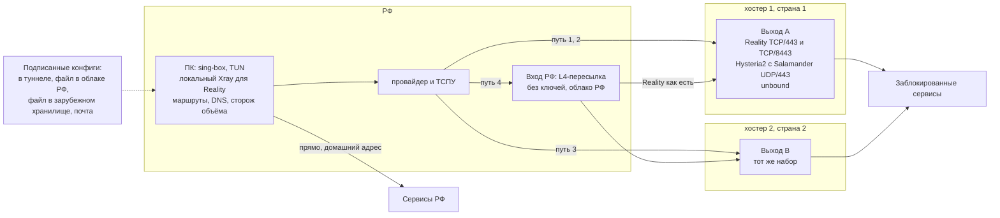

# Отказоустойчивая топология ПК в РФ -> заграничный сервер

Состояние источников на 02.11.2026. Ссылки вида [S3] ведут в раздел 10. Числа про стенд взяты только из `lab/results/`, про реальные сети только из `data/`.

**Коротко.** ПК в РФ с sing-box в режиме TUN и локальным Xray только для Reality. Российское идёт напрямую, остальное в туннель. Два выхода у разных хостеров и в разных AS, на каждом Reality на TCP/443 и Hysteria2 с Salamander на UDP/443. Запасной вход через ВМ в РФ как L4-пересылка без ключей: только для «занавеса» и белых списков. CDN в тракте данных нет. Конфиги подписаны и лежат в нескольких каналах. Проверяются и связность, и объём.

Своей точки в РФ у меня нет. Поэтому в работе раздельно: чужие замеры на настоящем ТСПУ, две московские точки check-host, OONI, моя модель на QEMU. Модель показывает, как протоколы реагируют на описанные правила, и не является ТСПУ. С абонентской линии ничего не мерилось. Переключение клиента замерено только на модели, раздел 8.3.

## 1. Что известно про ТСПУ

Сила источника: A рецензируемая работа с первичными данными, B открытые замеры или пресса со ссылкой на документ, C отчёты сообщества с техническими деталями, D одиночный отчёт. Всё, что ниже без ссылки, помечено словом «гипотеза».

| Поведение | Что наблюдали | Источник, дата, сила | В модели |
|---|---|---|---|
| Место и направление | Устройство стоит в пути, ведёт состояние, блокирует только соединения, начатые изнутри РФ. 70 % найденных точек не дальше двух хопов от абонента | [S1] IMC, 10.2022, A | вся модель работает на выход |
| Блок по SNI, RST | После ClientHello ответы сервера усекаются, флаги становятся RST/ACK, seq и TTL не меняются | [S1] A | `sni_rst` |
| Блок по SNI, дроп | Дроп с обеих сторон, включая сам ClientHello. Другой вариант: ещё 5-8 пакетов и симметричный дроп | [S1] A | `sni_drop` |
| QUIC | До середины 2023 блокировался весь QUIC v1 к UDP/443 от 1001 байта. Сейчас Initial дешифруется, блоклист SNI почти совпадает с TCP, дроп 4-кортежа на 420 с, все UDP-порты, только наружу, только v1 | [S2] FOCI, 2026, A | `quic_all`, `quic_sni` |
| WireGuard и OpenVPN | С 07.08.2023 массовые отчёты о блокировке у ряда ISP. Часть авторов называет порог числа пакетов после рукопожатия. Точная сигнатура не опубликована, моя сигнатура в модели это гипотеза | [S9] 08.2023, C | `vpn_sig` |
| «Занавес», TCP 16-20 | TLS к адресу в AS зарубежного хостинга, больше 15-20 КБ от сервера в одном соединении: заморозка без RST. Подтверждено Cloudflare для своих адресов с 09.06.2025. Сначала в основном мобильные сети, отчёты с проводных сетей с июля 2025, чаще с октября 2025. Позже описаны белый список SNI, белый список CIDR, счёт 25 пакетов в любую сторону для TCP и UDP, блок адреса на UDP около 10 минут | [S3] 06.2025-10.2025, C; [S4] 26.06.2025, B; [S5] инструмент | `curtain_tls`, `curtain_all` |
| Полностью зашифрованный поток | Для РФ описан не признак случайности, а рисунок HTTPS внутри туннеля: клиент шлёт не меньше трёх пакетов от 411 байт, сервер шлёт чаще клиента. Правила Ex1-Ex5 по первому пакету показаны только для GFW | [S7] 05.2024, C; [S8] GFW, 2023, A | `fet_ru`, `fet_gfw` |
| Полисинг TLS | С ноября 2025 на домашних сетях Reality+Vision умирает под нагрузкой, адрес восстанавливается примерно за 60 с, только порт 443, другие порты работают. С февраля 2026 волна блокировок, где Server Hello не возвращается. В мае 2026 отчёты о лимите числа соединений, порог называют 12 | [S6] 11.2025-02.2026, C; [S15] 22.05.2026, D | `conn_limit` |
| Баны по IP волнами | 04.08 и 21.09.2026 массовые баны адресов популярных VPS, в том числе с одной только AmneziaWG. В одной выборке 5 тысяч из 30 тысяч адресов AS, в другой 131 из 20 тысяч. Один адрес разблокировали через две недели | [S14] 09-10.2026, C | не моделируется, см. раздел 5 |
| Белые списки на мобильной сети | Режим, где проходит только разрешённое. В ЦФО в июле 2026 без ограничений 30,5 % сессий, в приграничных регионах почти 90 % сессий идёт по белому списку. Разрешения на уровне /24, различаются по региону и дню, разницу между операторами автор [S11] считает открытым вопросом. Пилот: 4 из 28 рабочих конфигов прошли по SIM, все VLESS+Reality с разрешённым SNI на разрешённом адресе, XHTTP 0 из 2, WebSocket 0 из 8 | [S10] 09.2025, C; [S13] 08.2026, B; [S11] 10.2026, C | `wl_ip` |
| Закрытие лазеек белого списка | Минцифры просит хостеров и CDN вынести разрешённые ресурсы в отдельные подсети, прямо называя VPN | [S12] 31.08.2026, B | нет |
| DNS | UDP DNS к 8.8.8.8 подменяется на многих ISP, TCP DNS работает. У провайдеров обязательный вышестоящий НСДИ | [S16] 26.08.2026, C; [S17] 02.2026, C | нет |
| Отпечатки DTLS | Фильтр по ja3/ja4 для Snowflake с 30.03.2026 | [S19] 04.2026, C | нет |
| Активное зондирование | Массовых зондов от ТСПУ в рассмотренных источниках нет, есть косвенные жалобы. Для GFW это норма. Для ТСПУ гипотеза | нет прямого источника | `run/probe.py` |
| Определение VPN на устройстве | 22 из 30 российских приложений определяют VPN, 19 отправляют статус на сервер. Методика включает проверку локальных прокси-портов, что позволяет узнать выходной адрес | [S20] 04.2026, B; [S21] 14.04.2026, D | нет |

Обзорных отчётов Censored Planet по ТСПУ за 2025-2026 я не нашёл. Полного текста RKS Global по белым спискам тоже нет, есть работа RKS про приложения [S20]. Рецензируемой работы про обнаружение Reality или XHTTP не нашёл. Всё, что сообщество пишет про «сломанный Reality», это отчёты пользователей без дампов, что отдельно замечено в самой ветке [S15].

## 2. Топология



```
                     РФ                         │            за границей
  ┌──────────────┐   ┌───────────┐              │
  │ ПК           │──▶│ провайдер │──путь 1,2──────────▶ Выход A (хостер 1, AS1)
  │ sing-box TUN │   │ + ТСПУ    │──путь 3────────────▶ Выход B (хостер 2, AS2)
  │ сторож       │   └─────┬─────┘              │        │
  └──────┬───────┘         └──путь 4──▶ Вход РФ ─────────┘ L4, шифр Reality не снимается
         │                              (облако)│
         └── сервисы РФ напрямую                │        выходы ──▶ заблокированные сервисы
```

Пути по порядку:

| Путь | Маршрут | Транспорт | Закрывает | Не закрывает |
|---|---|---|---|---|
| 1 | ПК -> Выход A | VLESS+Reality+Vision, TCP/443 | блок по SNI, сигнатуры VPN, признаки полностью зашифрованного потока | «занавес», бан адреса, полисинг TLS, белый список |
| 2 | ПК -> Выход A | Hysteria2 с Salamander, UDP/443 | всё из пути 1, блок TCP/443 при живом UDP, QUIC-фильтр | бан адреса, блок всего UDP, счёт пакетов из [S3] upd5 |
| 3 | ПК -> Выход B | то же, что пути 1 и 2 | бан адреса и AS выхода A, отказ хостера | «занавес» на всём диапазоне хостингов |
| 4 | ПК -> Вход РФ -> A или B | Reality с разрешённым SNI, пересылка L4 | «занавес» и белый список, пока адрес входа разрешён | закрытие подсетей [S12], блок трансграничного участка [S27] |

Что где стоит:

- **ПК.** sing-box в режиме TUN с `strict_route`, локальный Xray для Reality и маленький сторож объёма (раздел 4.3). sing-box ходит в Xray по SOCKS на 127.0.0.1 с паролем: локального SOCKS без авторизации нет [S21]. Ключи и список узлов лежат в файле, доступном только сервису.
- **Выходы A и B.** Xray VLESS+Reality на TCP/443, второй inbound Reality на TCP/8443 и Hysteria2 с Salamander на UDP/443, как в части 3. Второй inbound стоит из-за [S6], нужен он или нет, покажет только реальная сеть. `serverNames` держит несколько имён одного сайта-прикрытия, между ними SNI меняется конфигом клиента. Имя из белого списка с другого сайта требует смены `target`, то есть перенастройки узла. Рядом `unbound` только для туннельных клиентов, в пайплайн части 3 он пока не входит. Журналов доступа нет, есть счётчики. Разные хостеры, разные AS, разные страны, адреса не из тех, что перечислены в волнах [S14].
- **Вход РФ.** Одна маленькая ВМ в российском облаке с `nftables` DNAT на выходы. Ключей Reality на ней нет, TLS она не снимает. Выбирается на день включения: адрес проверяется из SIM того оператора, который нужен [S11]. Подробности цены в разделе 3.
- **Управление.** Подпись конфигов делается офлайн на моём маке. Каналы раздачи и мониторинг в разделах 4.4 и 4.5.

## 3. Решения и что отброшено

| Решение | Почему | Что отброшено и какой ценой |
|---|---|---|
| Два выхода в разных AS, не один сервер | Бан идёт по адресам и целым AS волнами [S14]. Один сервер это один адрес и один отказ | Один сервер дешевле вдвое и проще, но любой бан адреса превращается в простой на время смены узла (раздел 4.6) |
| Вход РФ есть, но это резервный путь 4, а не основной | Пока работает прямой путь, вход через РФ только добавляет юрисдикцию и хоп. Как часто прямой путь работает на абонентских линиях, у меня данных нет. При «занавесе» и белом списке прямой путь до хостинга мёртв по определению, а адрес внутри РФ этих правил не касается: стенд, раздел 8.2 | Всегда через РФ: каждый запрос проходит через хостера, который обязан подключиться к СОРМ [S28], и видно, кто и когда работает. Совсем без РФ: при режиме белого списка связи нет |
| Вход РФ это L4-пересылка без ключей | Захват входа даёт адреса клиента и выходов и объём, но не содержимое и не ключи | VLESS на входе с вторым туннелем дальше: можно менять транспорт на межсерверном участке, но вход тогда видит расшифрованный поток VLESS. Цена отказа: межсерверный участок идёт тем же Reality и зависит от того, как ТСПУ относится к серверным каналам [S27] |
| CDN не в тракте данных | Cloudflare под «занавесом» с июня 2025 [S4]. CDN снимает TLS и видит всё, что внутри, включая незашифрованный слой VLESS. Минцифры отдельно давит на CDN [S12] | CDN как запасной вход: прячет адрес выхода и даёт общий адрес с чужими сайтами. Цена отказа: нет пути на случай, когда все адреса выходов забанены разом. Закрываю сменой узла, а не CDN. CDN оставлен только для раздачи подписанного файла |
| Reality основной, Hysteria2 запасной (Р2) | На модели оба проходят SNI, сигнатуры и эвристику. Reality не требует домена и сертификата и выглядит как TLS к настоящему сайту. Hysteria2 живёт, когда режут TCP/443 | WireGuard и OpenVPN: узнаются по рукопожатию [S9], на стенде режутся сразу. AmneziaWG: проходит сигнатуры, но это UDP без маскировки под протокол, и её адреса попали под те же баны [S14]. Shadowsocks-2022: не выглядит как TLS, подпадает под [S7], Xray помечает его устаревшим. Вариант оставить как холодный резерв на выходах, данных против нет |
| Hysteria2 с Salamander, а не чистый HTTP/3 | QUIC-фильтр смотрит на Initial v1. С Salamander нет Initial, на стенде поток проходит и `quic_all`, и `quic_sni`. Чистый Hysteria2 зависит от того, какой период QUIC-фильтра у оператора | Без обфускации сервер отвечает как HTTP/3 и выдерживает зондирование. С Salamander это неопознанный UDP, настоящая проба QUIC не проходит [S25]. Цена: потеря маскировки, если начнут блокировать неопознанный UDP. Выбор проверяется на реальной сети первым |
| sing-box на ПК, Reality через локальный Xray | sing-box даёт TUN, правила, urltest, selector и Hysteria2. Reality сам до узла части 3 он не доводит: sing-box 1.14.4 вырезает X25519MLKEM768 из ClientHello [S30], Xray с 26.9.9 такой ClientHello отвергает [S31]. На стенде 0 из 3 против Xray 26.9.9 и 26.10.31, 3 из 3 против 26.6.27 (`lab/results/reality-compat.csv`). Группы и переключение остаются в sing-box | Один sing-box: один процесс, но узел тогда держится на Xray 26.6.27 или старше. Один Xray: родной XHTTP, но нет такого TUN и групп. Цена выбора: второй процесс на ПК, который надо обновлять. Плюс: если полисинг числа соединений подтвердится на моём операторе, XHTTP уже есть в том же Xray. Когда sing-box научится нужному ClientHello, Xray с ПК можно убрать |
| Разделение маршрутов: РФ напрямую, остальное в туннель | Российские приложения проверяют VPN [S20]. Через туннель они узнают адрес выхода и дают его сверить | Всё в туннель: проще и не течёт, но российские сервисы видят иностранный адрес, а выходной адрес попадает к тем, кто его может отдать в блокировку. Только список заблокированного в туннель: список вечно отстаёт, и незаблокированные зарубежные сервисы видят домашний адрес |

## 4. Как это работает

### 4.1 Маршруты на ПК

Весь трафик попадает в TUN, решения принимает sing-box по порядку:

1. Адреса входа и выходов, DHCP, локальная сеть: напрямую.
2. Процессы из списка (банки, госуслуги, российские приложения): напрямую, по `process_name`. Причина [S20]: приложение не должно видеть адрес выхода.
3. Домены и адреса РФ (`geosite-category-ru`, `geoip-ru`): напрямую.
4. UDP/443 в браузер при активном TCP-пути: отказ, браузер уходит на TCP. Иначе QUIC внутри TCP-туннеля даёт двойное управление перегрузкой.
5. Всё остальное: группа `auto`.

Обновления правил приходят вместе с подписанным набором (раздел 4.4). Правила не тянутся с GitHub напрямую при старте, чтобы клиент запускался без интернета.

### 4.2 DNS

- Адреса входа и выходов записаны в конфиг числами. Домены для них не используются, поэтому подмена DNS [S16] и НСДИ [S17] старту не мешают.
- Зарубежные имена: внутри туннеля к `unbound` на выходе, запрос идёт по TCP к адресу в туннеле. Плюс FakeIP в TUN, чтобы приложения не упирались в ответ DNS до выбора маршрута.
- Российские имена: к DNS провайдера напрямую. Иначе российские CDN отдадут узлы не того города, и DNS-запросы к внутренним именам уйдут за границу.
- UDP DNS к зарубежным резолверам мимо туннеля запрещён. Его подменяют [S16].
- Клиент не должен ходить за чужими доменами через системный резолвер. В TUN это ловится правилом на порт 53.

Что видно: провайдер видит запросы только по российским именам. `unbound` на выходе видит зарубежные имена всех клиентов выхода, журнал запросов выключен.

### 4.3 Автоматическое переключение

Два уровня, потому что отказы бывают двух видов (раздел 8.3).

**Уровень 1, связность.** `urltest` в sing-box: HEAD через каждый путь с интервалом 15 с, `tolerance` 300 мс, при переключении обрываются открытые соединения (`interrupt_exist_connections`). Ловит то, где соединение не устанавливается: бан адреса, блок порта, блок QUIC. Это страховка, а не быстрый механизм. Таймаут пробы зашит в sing-box и равен 15 с, настройки у него нет [S32], а настоящий период проверки длиннее заданного. Поэтому молчаливый отказ `urltest` не замечает быстрее 15 с, и уменьшение интервала мало что даёт (раздел 8.3).

**Уровень 2, объём, основной детектор.** Сторож `lab/run/watchdog.py`: каждые 5 с качает через текущий путь объект 256 КиБ, что больше порога «занавеса». Не докачалось за 4 с или скорость упала ниже 1 КиБ/с на 2 с: переключает `selector` на следующий путь и сбрасывает соединения через Clash API. Ловит заморозку, где маленькие запросы идут, а большие нет. Предел 4 с ломает узкий канал, на ПК отказом считается только остановка потока, предел докачки 30 с (раздел 8.3). На стенде сторож быстрее `urltest` на всех отказах, включая обычный бан адреса, поэтому основной детектор он, а не проверка связности.

На стенде уровни прогонялись порознь: либо `urltest`, либо `selector` со сторожем. На ПК они стоят вместе: `selector` сверху, в нём группа `urltest` и пути по отдельности. Такая связка не прогонялась.

Порядок обхода: 1, 2, 3, 4. Возврат (в стендовом стороже его нет, это план) на путь выше раз в 10 минут пробой объёма в обход текущего маршрута, чтобы не держать пользователя на входе РФ дольше нужного. Гистерезис нужен, чтобы блокировка с таймером 60 с [S6] не качала маршрут туда-сюда. Частота проб ограничена осознанно: сторож каждые 5 с по 256 КиБ это около 50 КБ/с постоянного трафика, на реальном клиенте интервал надо поднять, в простое проверять раз в минуту и только при наличии трафика в группе. Цена описана в разделе 6.

Запасные пути без трафика могут быть мертвы незаметно. Поэтому раз в час проба объёма идёт и по каждому резервному пути, результат идёт в телеметрию.

### 4.4 Раздача конфигов при блокировке канала

Конфиг содержит адреса выходов, поэтому утечка конфига приводит к блокировке адресов. Канал раздачи должен жить дольше, чем любой отдельный путь.

- Формат: JSON с номером версии и сроком годности, подпись ed25519 (ключ офлайн на маке), шифрование `age` на ключ клиента. Клиент принимает только версию больше текущей. Публичный ключ подписи вшит в клиент.
- Канал 1: внутри туннеля, через любой живой путь, раз в час. Новая версия приезжает заранее, до блокировки. Это основной канал.
- Канал 2: файл в объектном хранилище российского облака. Доступен в режиме белого списка, если адрес разрешён, то есть там, где остальное мертво.
- Канал 3: файл в зарубежном хранилище за CDN (не Cloudflare [S4]), имя файла производное от ключа клиента.
- Канал 4: письмо от меня вручную, файл открывается на ПК. Для полного отказа.

Перечитывать конфиг при старте и не падать, если каналы недоступны: последний рабочий конфиг продолжает работать. Часть каналов можно потерять, не потеряв связь, потому что шифрованный файл бесполезен цензору, а подпись защищает от подмены через чужой канал. Telegram не используется: заблокирован с марта 2026 [S22].

### 4.5 Мониторинг

Своей точки в РФ у стенда нет, поэтому внешний мониторинг в этой работе не развёрнут. Для боевой системы:

- Изнутри РФ: клиенты с согласием шлют агрегат «путь, AS, успех/отказ, байт до остановки» раз в час, без адреса клиента. Это единственный источник, который видит домашний и мобильный провайдер пользователя.
- Публичные точки: Globalping и check-host по своим адресам, редко. Они показывают доступность из дата-центров и не показывают «занавес» у абонента (раздел 8.5).
- Минимум одна постоянная проба на домашней линии и одна на SIM в РФ. Это деньги и решение владельца, а не техническая деталь.
- На выходах: живость `xray` и `hysteria`, число соединений, ошибки рукопожатия Reality, отдельный счётчик запросов не от клиентов, то есть то, что уходит в `target`. Рост такого трафика означает сканирование адреса.
- Публичные реестры блокировок мониторингом не считаю. Гипотеза: баны ТСПУ туда не попадают, проверять я это не стал.

### 4.6 Смена узла

- Образ не нужен: `cloud-init` ставит Xray и Hysteria2 с нуля, ключи генерируются на месте установки и новые для каждого узла.
- Новый узел всегда в другом адресе и, если бан по AS, у другого хостера. Заранее держу подготовленные учётные записи минимум у трёх хостеров, в разных платёжных схемах.
- Порядок: создать узел, проверить изнутри туннеля по уцелевшему пути, выпустить конфиг новой версии, дать ему разойтись, старый узел держать сутки для отстающих клиентов.
- Время создания узла измерено на DigitalOcean, раздел 8.4.

## 5. Отказы

«Стенд» значит измерено на модели: `lab/results/failover.csv` и `watchdog.csv`, медиана [мин..макс] из 10 повторов, разбор в разделе 8.3. Это время реакции клиента на заданное правило, а не прогноз для живой сети. «Расчёт» значит не мерилось. Время смены узла измерено на DigitalOcean. Времена сторожа в таблице сняты с пределом 4 с и шагом 5 с. На ПК выбраны предел 30 с и более редкие пробы, с ними замерены только `curtain_tls` и `ip_ban` (раздел 8.3), на остальных отказах реакция будет медленнее.

| Что отказало | Как обнаруживается | Что происходит | Сколько примерно | Откуда оценка |
|---|---|---|---|---|
| Бан адреса выхода A | сторож: 256 КиБ не докачались. `urltest`: проба молчит 15 с | сторож проходит мёртвый путь 2 и уходит на путь 3, затем замена адреса | сторож 14,1 [11,7..15,8] с, `urltest` 15 с: 36,3 [15,8..45,0] с; новый узел от 90-98 с (раздел 8.4) | стенд, `ip_ban`; `data/replace/replace.csv` |
| Режут только Reality, UDP жив | то же | путь 2 | сторож 4,0 [2,9..8,4] с, `urltest` 15 с: 27,5 [15,9..38,0] с | стенд, `model_sni`: дроп потока по SNI. Блок порта TCP/443 отдельно не прогонялся |
| Служба на выходе остановлена | сторож или `urltest`: порт закрыт, ответ сразу | путь 2 | сторож 6,1 [0,4..7,3] с, `urltest` 15 с: 16,7 [3,0..32,2] с | стенд, `service_stop` |
| «Занавес» на TLS | только сторож объёма. `urltest` не переключился ни разу из 10 за 70 с | путь 2 | первый успех 256 КиБ через 7,5 [5,1..9,4] с, с пределом докачки 30 с 10,7 [8,6..13,4] с. Первый поток обрывается | стенд, `model_curtain`, `wd_curtain_tls`, `limit30_curtain_tls` |
| «Занавес» со счётом пакетов | сторож, по шагу на путь | пути 2 и 3 тоже мертвы, сторож доходит до пути 4 | 21,2 [18,3..23,0] с | стенд, `wd_curtain_all`, путь 4 там адрес вне хостинга, а не настоящий вход в РФ |
| Блок всего UDP или QUIC | резервная проба раз в час | ничего, пока работает путь 1. Путь 2 числится мёртвым | до 1 часа на обнаружение | расчёт |
| Полисинг TLS, лимит соединений | сторож объёма | смена пути, через 60 с адрес оживает [S6] | секунды, повторяется при нагрузке | чужой отчёт, не измерено |
| Волна банов по AS | все пути хостера падают | выход B, новый узел у другого хостера | как бан адреса; покупка у нового хостера вручную | расчёт по `ip_ban`, время покупки не измерено |
| Хостер снёс выход | как бан адреса | то же | то же | расчёт по `ip_ban` |
| Белый список на мобильной сети | все зарубежные пути мертвы | путь 4, если адрес разрешён. Иначе связи нет | неизвестно | [S11] |
| Вход РФ снят или забанен | резервная проба | остаются пути 1-3, новый вход вручную | минуты, плюс проверка с SIM | не измерено |
| Каналы раздачи заблокированы | ошибки загрузки | старый конфиг работает | до следующего живого канала | по устройству |
| Выходы забанены все разом, новый адрес не доставить | клиент без связи | письмо с файлом | часы, вручную | оценка без замера |
| Отравленный DNS | не влияет на старт | адреса в конфиге числами | 0 | по устройству |
| Утечка конфига | рост чужих подключений в счётчиках | отзыв ключа клиента, смена адресов | как смена узла плюс выпуск | не измерено |
| Компрометация ключа подписи | только внешним сигналом | ручная перевыдача | дни | оценка без замера |
| Отключение сети в регионе | нет связи вообще | ничего сделать нельзя | до включения | вне модели |

## 6. Слабые места

1. **Белый список на мобильной сети не решается топологией.** Работает только адрес из разрешённой /24 плюс разрешённый SNI, и то не всегда: 4 из 28 у пилота [S11], список зависит от региона и дня. Минцифры закрывает эту лазейку [S12]. На SIM система может просто не работать.
2. **Неотличимость Reality никем не доказана.** Рецензируемых замеров нет. Есть отчёты, что Reality падает волнами [S6] [S14] [S15], и нет дампов, которые показали бы признак. Возможный признак по гипотезе: SNI крупного сайта при адресе чужого AS. Документация Xray сама советует брать `target` из своего AS [S23]. На моей модели такого правила нет.
3. **Если «занавес» накрывает весь диапазон хостингов, вся нагрузка ложится на вход РФ.** Это одна ВМ в одной юрисдикции с СОРМ [S28].
4. **Вход РФ раскрывает связь.** Хостер видит адрес клиента, адрес выхода, время и объём, а у аренды есть плательщик с идентификацией. Содержимое он не видит, но для ответа на вопрос «кто пользуется обходом» этого хватает.
5. **Трансграничный участок входа не измерен.** Отчёты говорят, что серверные каналы фильтруются мягче, но жёстче, чем раньше [S27]. Стенд этого не показывает: вход и выход там на одной ВМ.
6. **Hysteria2 с Salamander это неопознанный UDP.** Правило «режем всё UDP к хостингам» убивает путь 2 целиком, такие отчёты на мобильных сетях уже есть [S26]. Без Salamander есть зависимость от того, какой период QUIC-фильтра действует.
7. **Сторож объёма сам виден.** Периодическое скачивание одного размера с одного адреса это рисунок. И реакция идёт после отказа: первый оборвавшийся поток пользователь заметит.
8. **Мониторинга из РФ сейчас нет.** Всё, что я знаю про живость путей у абонента, приходит от самих клиентов, то есть только когда есть живой канал.
9. **Объём на один адрес виден цензору.** В отчёте [S14] VPS с 130 ГБ за 8 дней потерял TCP по всей РФ, через две недели без действий блок сняли. Рассчитывать число пользователей на адрес не из чего: опубликованных порогов нет.
10. **Разделение маршрутов течёт по краям.** Список процессов и доменов неполон. Приложение в туннеле может узнать адрес выхода. Напрямую идущий трафик виден провайдеру как обычно. IPv6 в TUN надо закрывать явно, иначе часть запросов уйдёт мимо.
11. **Один ключ подписи на одном маке.** Потеря ключа это ручная перевыдача всем клиентам. Отзыв ключа через канал не проверялся.
12. **Выход это адрес дата-центра.** Часть сервисов сама не пускает такие адреса или показывает капчу. К блокировке РФ это отношения не имеет, но доступ к сервису тоже ломает. Лечится ещё одним хопом и новым доверенным участником, здесь не делается.
13. **Reality на клиенте держится на паре версий.** Обновление Xray на узле до 26.9.9 отрезало sing-box и mihomo без единой ошибки на сервере выше уровня Info [S31]. На клиенте это выглядит как `x509: certificate signed by unknown authority`. Версии закреплены, как в части 3, а узел обновляется только после пробы действующим клиентом.
14. **Стенд ничего не доказывает про настоящий ТСПУ.** Он показывает только поведение протоколов при заявленных правилах. Цифры раздела 8.2 не надо читать как прогноз для живой сети.

## 7. Граница доверия

| Участник | Что видит | Что может | Кому и зачем надо верить |
|---|---|---|---|
| ПК и его ОС | всё в открытом виде, ключи, конфиг | всё | Полное доверие. Взлом ПК обнуляет систему |
| Провайдер и ТСПУ | адрес ПК, адреса и порты путей, SNI, объём, время, российский трафик и российский DNS | блокировать, тормозить, подменять открытый трафик, зондировать, сопоставлять с данными абонента | Не доверяю. Содержимое TLS 1.3 не видит, пока целы ключи X25519 и нет активного MITM с настоящим сертификатом |
| Хостер входа РФ | адрес ПК, адрес выхода, объём, время | всё то же, отдать по СОРМ, снять ВМ | Не доверяю содержимому, поэтому там нет ключей. Метаданные считаю раскрытыми |
| Хостер выхода | адрес ПК (на путях 1-3) или входа, назначения, открытый трафик клиента, ключи Xray и Hysteria2 в памяти ВМ | читать всё, что не защищено TLS внутри, подменять сервер | Вынужденное доверие. Клиент должен пользоваться внутренним TLS. Разные хостеры ограничивают ущерб только по времени и доле трафика |
| CDN | для раздачи конфигов: адрес запросившего и имя файла. В тракте данных его нет | отдать или не отдать файл | Нет: файл зашифрован и подписан |
| DNS | провайдер и НСДИ: российские имена. `unbound` на выходе: зарубежные имена | подменить российские ответы | Подмена российских имён остаётся в силе. Зарубежные защищены туннелем только до выхода, дальше обычный DNS, DNSSEC проверяется на `unbound` |
| Автор конфигов (я) | все ключи и адреса всех выходов, плательщик узлов | выпустить вредный конфиг, например завернуть трафик на свой узел | Полное доверие. Подпись защищает от чужого, а не от автора |
| Клиентское ПО (sing-box, Xray, сторож) | весь трафик до шифрования, ключи | всё | Открытый код, но я не читаю каждый релиз. Сборка из чужого бинарника |
| Поставка обновлений | версию ПО, адрес запроса к GitHub | подменить релиз, если взломан аккаунт сопровождающего | Закрепление версии и контрольной суммы, обновление вручную после проверки на стенде. Ключа подписи релизов у sing-box я не проверял |
| Конечный сервис | адрес выхода, аккаунт пользователя | связать аккаунт, отпечаток браузера, cookies | Обход этого не скрывает |

**Модель нарушителя.**

- Н1. Цензор на пути. Массовый, цель: не дать связи. Видит метаданные, инжектит и режет, знает AS хостингов, меняет правила без объявления, может зондировать (гипотеза). Считаю, что он не ломает TLS 1.3 и X25519, не держит белый список на проводных сетях повсеместно (допущение, с ним разваливается пункт 1 раздела 6).
- Н2. Оператор или хостер по законному запросу. Отдаёт метаданные, по [S28] это штатный путь на входе РФ.
- Н3. Хостер выхода или взломщик выхода. Читает открытый трафик и видит адрес клиента.
- Н4. Вредоносное или любопытное приложение на ПК, включая российские приложения с проверкой VPN [S20].
- Н5. Человек, получивший конфиг. Может использовать узел и передать адреса в блокировку. Защита только частичная: персональные ключи и отзыв по одному.
- Н6. Цепочка поставки.

Система рассчитана на Н1 и частично на Н5. От Н2 она защищает содержимое, но не факт использования. От Н3 защищает только внутренний TLS. От Н4 и Н6 не защищает.

**Чего система не гарантирует.** Анонимности: провайдер видит факт потока к адресу, выход видит адрес клиента и назначения, сервис видит аккаунт. Защиты от взлома устройства и от изъятия устройства. Доступности при отключении сети оператором или при белом списке на проводной линии. Скрытия факта использования обхода при целевом интересе. Законности применения в конкретной ситуации: это отдельный вопрос, а не свойство топологии.

## 8. Замеры

### 8.1 Что чем измерено

| Что | Кто и где мерил | Что это даёт |
|---|---|---|
| Настоящий ТСПУ, чужие замеры | авторы [S1] [S2], сообщество [S3] [S6] [S7], Cloudflare [S4], OONI | поведение и пороги, с датой и силой из раздела 1 |
| Настоящие сети РФ, мои запросы к своему адресу | check-host: два узла в дата-центрах Москвы | доступность и объём с этих двух точек, разделы 8.5 и 8.6 |
| Модель на QEMU, мои замеры | три ВМ на маке, `lab/` | реакция протоколов на заявленные правила, и только это |
| Не измерено | ничего из моего набора протоколов не прогонялось с абонентской линии или SIM в РФ | своей точки в РФ нет. Как это исправить: раздел 8.8 |

Модель это не ТСПУ. Числа раздела 8.2 нельзя переносить на живую сеть.

### 8.2 Стенд

Сборка и повтор описаны в `lab/README.md`. Debian 13 arm64, 2 vCPU и 2 ГБ на ВМ, Xray 26.10.31, Hysteria 2.13.0, sing-box 1.14.4, OpenVPN и WireGuard из Debian, amneziawg-go из исходников. RTT 40 мс задан netem. Контроль 15 повторов, `pass` 7, остальные сценарии 5. Каждый повтор начинается с чистого состояния модели и conntrack. Всего 1275 строк в `lab/results/matrix.csv`.

Стенд пересобран с нуля по `lab/README.md` на новых дисках после всех правок: 1066 с, из них подъём ВМ 23 с, установка 156 с, конфиги 4 с, проба 883 с. Проба на новых дисках дала 13 из 13 (`lab/results/proof-rebuild.csv`), ВМ при этом шли с 1,3 ГБ вместо 2 ГБ. Матрица и `proof.csv` сняты на прежних дисках, раздел 8.3 и `reality-compat.csv` на новых.

**Проба стенда** (`lab/results/proof.csv`): 13 пар правило-протокол, по 5 повторов, модель выключена и включена. Выключена: 5 из 5 во всех парах, включая заведомо запрещённое. Включена: 0 из 5 во всех парах, кроме `conn_limit`, где одиночный запрос проходит по определению правила, а из 20 одновременных не проходит ни один. Итог: 13 из 13, замер имеет смысл.

Успешная загрузка 1 МиБ, успехов из повторов. Звёздочка: 1 КиБ проходит, а 1 МиБ нет, то есть заморозка на объёме.

| сценарий | https-ok | https-blocked | https-wl | wg | awg | ovpn-udp | ovpn-tcp | ss2022 | reality | reality-wl | reality-mux | xhttp | hy2 | hy2-blk | hy2-obfs |
|---|---|---|---|---|---|---|---|---|---|---|---|---|---|---|---|
| off | 15/15 | 15/15 | 15/15 | 15/15 | 15/15 | 15/15 | 15/15 | 15/15 | 15/15 | 15/15 | 15/15 | 15/15 | 15/15 | 15/15 | 15/15 |
| pass | 7/7 | 7/7 | 7/7 | 7/7 | 7/7 | 7/7 | 7/7 | 7/7 | 7/7 | 7/7 | 7/7 | 7/7 | 7/7 | 7/7 | 7/7 |
| sni_rst | 5/5 | 0/5 | 5/5 | 5/5 | 5/5 | 5/5 | 5/5 | 5/5 | 5/5 | 5/5 | 5/5 | 5/5 | 5/5 | 5/5 | 5/5 |
| sni_drop | 5/5 | 0/5 | 5/5 | 5/5 | 5/5 | 5/5 | 5/5 | 5/5 | 5/5 | 5/5 | 5/5 | 5/5 | 5/5 | 5/5 | 5/5 |
| quic_all | 5/5 | 5/5 | 5/5 | 5/5 | 5/5 | 5/5 | 5/5 | 5/5 | 5/5 | 5/5 | 5/5 | 5/5 | 0/5 | 0/5 | 5/5 |
| quic_sni | 5/5 | 5/5 | 5/5 | 5/5 | 5/5 | 5/5 | 5/5 | 5/5 | 5/5 | 5/5 | 5/5 | 5/5 | 5/5 | 0/5 | 5/5 |
| vpn_sig | 5/5 | 5/5 | 5/5 | 0/5 | 5/5 | 0/5 | 0/5 | 5/5 | 5/5 | 5/5 | 5/5 | 5/5 | 5/5 | 5/5 | 5/5 |
| curtain_tls | 0/5* | 0/5* | 5/5 | 5/5 | 5/5 | 5/5 | 5/5 | 5/5 | 0/5* | 5/5 | 0/5* | 0/5* | 5/5 | 5/5 | 5/5 |
| curtain_all | 0/5* | 0/5* | 5/5 | 0/5* | 0/5* | 0/5* | 0/5* | 0/5* | 0/5* | 5/5 | 0/5* | 0/5* | 0/5* | 0/5* | 0/5* |
| fet_gfw | 5/5 | 5/5 | 5/5 | 5/5 | 5/5 | 5/5 | 5/5 | 0/5 | 5/5 | 5/5 | 5/5 | 5/5 | 5/5 | 5/5 | 5/5 |
| fet_ru | 5/5 | 5/5 | 5/5 | 5/5 | 5/5 | 5/5 | 0/5 | 0/5* | 5/5 | 5/5 | 5/5 | 5/5 | 5/5 | 5/5 | 5/5 |
| conn_limit | 5/5 | 5/5 | 5/5 | 5/5 | 5/5 | 5/5 | 5/5 | 5/5 | 5/5 | 5/5 | 5/5 | 5/5 | 5/5 | 5/5 | 5/5 |
| wl_ip | 0/5 | 0/5 | 0/5 | 0/5 | 0/5 | 0/5 | 0/5 | 0/5 | 0/5 | 0/5 | 0/5 | 0/5 | 0/5 | 0/5 | 0/5 |
| curtain_tls (адрес вне хостинга) | 5/5 | - | - | 5/5 | 5/5 | - | - | 5/5 | 5/5 | - | - | 5/5 | 4/5 | - | 5/5 |
| curtain_all (адрес вне хостинга) | 5/5 | - | - | 5/5 | 0/5* | - | - | 5/5 | 5/5 | - | - | 5/5 | 3/5 | - | 5/5 |
| wl_ip (адрес вне хостинга) | 5/5 | - | - | 5/5 | 0/5 | - | - | 5/5 | 5/5 | - | - | 5/5 | 3/5 | - | 5/5 |

Примечание про артефакты стенда. На адресе вне хостинга `awg` падает из-за самого стенда: amneziawg-go отвечает с основного адреса `.2`, клиент переезжает на него (захват на клиенте), и поток снова попадает в хостинг. Эти ячейки не считаю. `hy2` там же 4/5 и 3/5. При выключенной модели на этом адресе 8 из 20, на обычном адресе 5 из 5, у `hy2-obfs` вне хостинга 20 из 20 (`lab/results/ruhost-hy2.csv`). Значит, это путь через DNAT на ВМ, а не правило. Почему он задевает только чистый вариант, я не разбирал.

Что видно:

- **SNI.** Режутся только прямые HTTPS с именем из блоклиста. Туннели с нейтральным SNI не задеты. Reality с блокированным SNI в матрице не прогонялся, в замере переключения прогонялся: `sni_drop` режет его так же, строки `model_sni` в разделе 8.3.
- **QUIC.** `quic_all` убивает Hysteria2 без обфускации при любом SNI. `quic_sni` убивает только вариант с именем из блоклиста. Salamander проходит оба, потому что Initial v1 на проводе нет. Значит, для чистого Hysteria2 важно, какой период QUIC-фильтра у оператора. По [S2] сейчас период C, отчёт [S26] с мобильной сети говорит о другом.
- **Сигнатуры.** WireGuard и OpenVPN 0 из 5. AmneziaWG 5 из 5, но это только про мою сигнатуру. Баны адресов [S14] её не обходят.
- **«Занавес» по [S3], исходное описание.** Все TLS-потоки к хостингу замирают, включая Reality, XHTTP и mux. До остановки на проводе 11-18 КБ (таблица ниже), для HTTPS полезная нагрузка 0: запись TLS 16 КиБ не успевает доехать целиком. UDP и не-TLS правилом не задеты, но это граница этого варианта правила: upd2 в [S3] говорит, что сырой TCP тоже ограничен.
- **«Занавес» по upd5.** Умирает всё, включая Hysteria2 с Salamander. Напрямую выживает только Reality с SNI из белого списка. Любой протокол на адресе вне множества хостингов проходит. Это главный вывод для топологии: от этого режима спасают не свойства протокола, а адрес и SNI.
- **Эвристика.** `fet_gfw` режет только Shadowsocks-2022, остальные снаружи похожи на TLS, HTTP или это UDP. `fet_ru` режет Shadowsocks-2022 и OpenVPN по TCP, причём у Shadowsocks маленькие ответы проходят, а поток замирает около 22 КБ на проводе. Reality и XHTTP проходят, потому что правило описано для не-TLS потоков.
- **Лимит соединений.** Reality с Vision открывает по TCP-соединению на каждый внутренний поток, и из 20 одновременных запросов не завершается ни один. Mux и XHTTP держат всё в малом числе соединений и завершают 20 из 20. Это совпадает с советом в [S6], но там же сказано, что на части провайдеров это потом перестало помогать, а в пилоте [S11] XHTTP прошёл 0 из 2 по SIM. Модель тут оптимистичнее реальности.
- **Белый список.** Всё к зарубежному адресу мертво, всё к разрешённому адресу живо. Модель не проверяет SNI на разрешённом адресе, поэтому здесь она точно оптимистичнее [S11].

Контроль, модель выключена. Медиана [мин..макс].

| протокол | n | первый байт с холодного старта, с | 16 МиБ, Мбит/с | накладные, % |
|---|---|---|---|---|
| https-ok | 15 | 0.142 [0.137..0.150] | 115.5 [58.4..163.0] | 4.87 [4.87..4.88] |
| https-blocked | 15 | 0.140 [0.135..0.148] | 86.1 [58.2..185.8] | 4.87 [4.87..4.88] |
| https-wl | 15 | 0.139 [0.132..0.146] | 109.9 [57.7..190.0] | 4.87 [4.87..4.88] |
| wg | 15 | 0.147 [0.139..0.154] | 79.3 [54.0..168.9] | 9.22 [9.22..9.22] |
| awg | 15 | 0.151 [0.143..0.159] | 125.1 [52.2..204.8] | 9.22 [9.22..9.22] |
| ovpn-udp | 15 | 0.296 [0.289..0.302] | 15.9 [15.5..16.5] | 9.69 [8.58..11.67] |
| ovpn-tcp | 15 | 0.786 [0.636..0.884] | 29.0 [27.0..109.9] | 10.54 [10.52..10.55] |
| ss2022 | 15 | 0.152 [0.144..0.161] | 141.5 [57.7..199.2] | 5.01 [5.00..5.01] |
| reality | 15 | 0.200 [0.191..0.205] | 125.9 [53.6..186.1] | 4.89 [4.86..4.90] |
| reality-wl | 15 | 0.199 [0.188..0.206] | 86.6 [60.0..186.1] | 4.89 [4.87..4.91] |
| reality-mux | 15 | 0.200 [0.194..0.208] | 116.2 [73.6..232.0] | 5.23 [5.23..5.25] |
| xhttp | 15 | 0.199 [0.185..0.209] | 104.3 [64.0..178.5] | 5.00 [4.99..5.11] |
| hy2 | 15 | 0.200 [0.191..0.207] | 450.5 [393.3..462.5] | 4.93 [4.93..8.90] |
| hy2-blk | 15 | 0.197 [0.193..0.202] | 447.4 [408.0..482.7] | 4.94 [4.93..8.47] |
| hy2-obfs | 15 | 0.199 [0.192..0.206] | 456.4 [438.5..475.2] | 5.53 [5.52..5.53] |

Накладные расходы считаются на интерфейсе, включая заголовки Ethernet, базовый уровень для TCP с MTU 1500 это 4,87 % у обычного HTTPS. Reality, XHTTP и Hysteria2 дают к этому доли процента. Salamander около 0,6 %. WireGuard и AmneziaWG около 9 %, потому что TCP внутри живёт с меньшим MSS и добавляются заголовки, OpenVPN 9-11 %. Первый байт с холодного старта у Reality, XHTTP и Hysteria2 одинаков, около 0,2 с при RTT 40 мс. Скорость TCP-транспортов без OpenVPN на файле 16 МиБ разбросана от 54 до 232 Мбит/с, разница медиан между ними меньше разброса и выводов не даёт. Hysteria2 с BBR около 450 Мбит/с стабильно, но на линии без потерь и с двумя виртуальными ядрами это ни о чём, кроме стенда, не говорит.

Цена модели, сценарий pass.

| протокол | n | первый байт, с | 16 МиБ, Мбит/с |
|---|---|---|---|
| https-ok | 7 | 0.137 [0.133..0.146] | 109.2 [61.6..181.8] |
| https-blocked | 7 | 0.139 [0.135..0.141] | 160.2 [57.7..195.6] |
| https-wl | 7 | 0.145 [0.138..0.147] | 94.5 [55.9..189.2] |
| wg | 7 | 0.145 [0.141..0.147] | 128.4 [56.2..167.8] |
| awg | 7 | 0.151 [0.144..0.156] | 80.9 [74.2..205.2] |
| ovpn-udp | 7 | 0.296 [0.289..0.304] | 15.8 [15.5..16.1] |
| ovpn-tcp | 7 | 0.822 [0.652..0.858] | 31.9 [28.2..93.3] |
| ss2022 | 7 | 0.147 [0.146..0.153] | 61.7 [59.5..161.9] |
| reality | 7 | 0.193 [0.188..0.205] | 68.6 [53.4..169.7] |
| reality-wl | 7 | 0.194 [0.187..0.199] | 80.0 [59.2..175.3] |
| reality-mux | 7 | 0.195 [0.189..0.198] | 87.4 [73.1..417.5] |
| xhttp | 7 | 0.192 [0.186..0.200] | 118.3 [55.6..170.9] |
| hy2 | 7 | 0.199 [0.195..0.207] | 442.2 [414.1..459.3] |
| hy2-blk | 7 | 0.197 [0.194..0.202] | 434.9 [393.7..477.7] |
| hy2-obfs | 7 | 0.198 [0.193..0.202] | 455.6 [447.8..473.6] |

Цена самой модели: первый байт не изменился, разница медиан скорости меньше разброса. По `https-ok`, `reality`, `xhttp` и `ss2022` вместе медиана 110 Мбит/с в контроле и 101 Мбит/с в `pass`, размах 54-199 и 53-182.

Байт до остановки на проводе (wire_rx_1m) и полезной нагрузки (bytes_1m), заморозка. Медиана [мин..макс].

| сценарий | протокол | n | на проводе | полезная нагрузка |
|---|---|---|---|---|
| curtain_tls | https-ok | 5 | 16072 [15928..16326] | 0 [0..0] |
| curtain_tls | https-blocked | 5 | 15501 [14004..15560] | 0 [0..0] |
| curtain_tls | reality | 5 | 16745 [12528..17549] | 8192 [7932..12028] |
| curtain_tls | reality-mux | 5 | 12722 [10824..13924] | 7932 [7932..8192] |
| curtain_tls | xhttp | 5 | 14003 [11018..15279] | 7932 [0..8192] |
| curtain_all | https-ok | 5 | 27640 [27599..32121] | 16366 [16366..16366] |
| curtain_all | https-blocked | 5 | 27631 [27329..30640] | 16366 [16366..16366] |
| curtain_all | wg | 5 | 20272 [20230..21744] | 17784 [17784..17784] |
| curtain_all | awg | 5 | 47312 [46092..56318] | 41040 [39672..41040] |
| curtain_all | ovpn-udp | 5 | 20444 [18766..21367] | 13880 [13880..13880] |
| curtain_all | ovpn-tcp | 5 | 4110 [1084..11564] | 0 [0..4122] |
| curtain_all | ss2022 | 5 | 35278 [34653..35713] | 24576 [24576..24576] |
| curtain_all | reality | 5 | 29870 [28903..31179] | 20220 [20220..20480] |
| curtain_all | reality-mux | 5 | 18328 [18068..19980] | 8192 [7932..16124] |
| curtain_all | xhttp | 5 | 24730 [23511..26447] | 16384 [16124..16384] |
| curtain_all | hy2 | 5 | 17424 [14213..18467] | 15084 [12570..16081] |
| curtain_all | hy2-blk | 5 | 16754 [15853..18453] | 14824 [13827..15084] |
| curtain_all | hy2-obfs | 5 | 17713 [15698..18802] | 15084 [13827..16081] |

conn_limit: завершилось из 20 одновременных. Медиана [мин..макс].

| протокол | off | conn_limit |
|---|---|---|
| https-ok | 20 [20..20] | 0 [0..0] |
| https-blocked | 20 [20..20] | 0 [0..0] |
| https-wl | 20 [20..20] | 0 [0..0] |
| wg | 20 [20..20] | 20 [20..20] |
| awg | 20 [20..20] | 20 [20..20] |
| ovpn-udp | 20 [20..20] | 20 [20..20] |
| ovpn-tcp | 20 [20..20] | 20 [20..20] |
| ss2022 | 20 [20..20] | 20 [20..20] |
| reality | 20 [20..20] | 0 [0..0] |
| reality-wl | 20 [20..20] | 0 [0..0] |
| reality-mux | 20 [20..20] | 20 [20..20] |
| xhttp | 20 [20..20] | 20 [20..20] |
| hy2 | 20 [20..20] | 20 [20..20] |
| hy2-blk | 20 [20..20] | 20 [20..20] |
| hy2-obfs | 20 [20..20] | 20 [20..20] |

Активное зондирование (`lab/results/probe.csv`, 5 повторов на цель и пробу). Для ТСПУ это гипотеза, поэтому смотреть надо только на то, что сервис отдаёт незнакомцу:

| цель | проба | результат из 5 | байт ответа |
|---|---|---|---|
| https | random64 | rst 5 | 0 |
| https | http_get | fin 5 | 407 |
| https | tls_listed_sni | tls_ok 5 | 0 |
| https | tls_unlisted_sni | tls_ok 5 | 0 |
| reality | random64 | fin 5 | 0/309 |
| reality | http_get | fin 5 | 407 |
| reality | tls_listed_sni | tls_ok 5 | 0 |
| reality | tls_unlisted_sni | tls_ok 5 | 0 |
| xhttp | random64 | fin 5 | 0/309 |
| xhttp | http_get | fin 5 | 407 |
| xhttp | tls_listed_sni | tls_ok 5 | 0 |
| xhttp | tls_unlisted_sni | tls_ok 5 | 0 |
| ss2022 | random64 | rst 5 | 0 |
| ss2022 | http_get | rst 5 | 0 |
| ss2022 | tls_listed_sni | tls_fail 5 | 0 |
| ss2022 | tls_unlisted_sni | tls_fail 5 | 0 |
| ovpn-tcp | random64 | fin 5 | 0 |
| ovpn-tcp | http_get | fin 5 | 0 |
| ovpn-tcp | tls_listed_sni | tls_fail 5 | 0 |
| ovpn-tcp | tls_unlisted_sni | tls_fail 5 | 0 |
| wg | random1200 | silent 5 | 0 |
| wg | quic_v1_h3 | quic_fail 5 | 0 |
| awg | random1200 | silent 5 | 0 |
| awg | quic_v1_h3 | quic_fail 5 | 0 |
| ovpn-udp | random1200 | silent 5 | 0 |
| ovpn-udp | quic_v1_h3 | quic_fail 5 | 0 |
| hy2 | random1200 | reply 1, silent 4 | 0/42 |
| hy2 | quic_v1_h3 | quic_ok 5 | 0 |
| hy2-obfs | random1200 | silent 5 | 0 |
| hy2-obfs | quic_v1_h3 | quic_fail 5 | 0 |

Сертификат у https, reality и xhttp один и тот же (`e3a109d4b...`), это сертификат `target`. ss2022 и OpenVPN на TLS не отвечают. Hysteria2 без обфускации проходит настоящее рукопожатие QUIC, а на мусор в 1 случае из 5 ответил пакетом 42 байта. С Salamander рукопожатие не проходит, на мусор молчит 5 из 5.

### 8.3 Переключение клиента

Метод в `lab/README.md`, данные в `lab/results/failover.csv` и `watchdog.csv`, таблицы собирает `lab/run/fotable.py`. Клиент sing-box 1.14.4 в ВМ, вход SOCKS вместо TUN. Путь 1 Reality через локальный Xray, путь 2 Hysteria2 с Salamander на том же адресе, путь 3 Hysteria2 с Salamander на другом адресе. Запрос каждые 0,25 с, каждый в новом соединении. Метрика: от начала отказа до конца первого успешного запроса через запасной путь. Путь каждого запроса взят из журнала sing-box, момент отказа случайный.

Первый прогон этого замера был ложным: Reality через sing-box вообще не поднимался, раздел 3, поэтому отказ на Reality никого не задевал. Теперь перед каждым отказом Clash API и журнал должны показать Reality, иначе строка недействительна. Таких строк 3 из 103: за прогон повторился локальный порт, и моя проверка приняла запрос после отказа за запрос до него. Они остались в CSV и заменены повторами, разбор поправлен.

| механизм | отказ | n | куда ушёл | до первого успеха через запасной путь, с | разрыв в работе, с | запросов потеряно |
|---|---|---|---|---|---|---|
| urltest 15 с | model_sni | 10 | hy2s 10 | 27.5 [15.9..38.0] | 27.2 [15.9..38.0] | 105.5 [61..148] |
| urltest 15 с | service_stop | 10 | hy2s 10 | 16.7 [3.0..32.2] | 16.8 [3.1..32.1] | 65.5 [11..126] |
| urltest 15 с | ip_ban | 10 | exit2 10 | 36.3 [15.8..45.0] | 36.3 [15.9..45.1] | 141.5 [61..176] |
| urltest 5 с | model_sni | 10 | hy2s 10 | 20.5 [15.3..24.3] | 20.3 [15.3..24.3] | 80 [60..96] |
| urltest 5 с | service_stop | 10 | hy2s 10 | 7.5 [5.0..11.8] | 7.6 [5.0..11.9] | 29 [19..46] |
| urltest 5 с | ip_ban | 10 | exit2 10 | 20.1 [16.4..23.4] | 20.2 [16.6..23.5] | 79.5 [65..93] |
| сторож 5 с | model_sni | 10 | hy2s 10 | 4.0 [2.9..8.4] | 3.9 [2.7..8.3] | 14.5 [10..32] |
| сторож 5 с | service_stop | 10 | hy2s 10 | 6.1 [0.4..7.3] | 6.3 [0.5..7.3] | 24 [1..28] |
| сторож 5 с | ip_ban | 10 | exit2 10 | 14.1 [11.7..15.8] | 14.2 [11.7..15.9] | 55 [45..62] |
| urltest 15 с | model_curtain | 10 | нет 10 | нет за 70 | - | 263 [260..264] |

Мак во время замера делил ресурсы с другими задачами, средняя нагрузка от 7 до 37, поэтому десятые доли секунды читать не надо.

Что это показывает:

- **`urltest` медленнее моего расчёта.** Было заложено «до 15 с плюс таймаут», при бане адреса измерено до 45,0 с. Причин две. Таймаут пробы 15 с зашит в код [S32]. Настоящий период проверки длиннее заданного: при интервале 15 с он после первого шага 30 с, при интервале 5 с от 8 до 15 с (журналы sing-box, `lab/results/urltest-period.csv`), потому что путь со свежей историей на тике пропускается.
- **Интервал не лечит молчаливый отказ.** С 15 до 5 с медиана `model_sni` падает с 27,5 до 20,5 с, `ip_ban` с 36,3 до 20,1 с, но минимум в обоих режимах 15-16 с, это и есть зашитый таймаут. Заметнее всего интервал помогает там, где проба падает сразу: `service_stop` с 16,7 до 7,5 с. Частая проверка стоит трафика и окупается только сокращением верхней границы.
- **Сторож быстрее на всех отказах связности.** 4,0 с против 27,5 с на `model_sni`, 14,1 с против 36,3 с на `ip_ban`. Он замечает отказ по первому зависшему объёму и не ждёт таймаут в 15 с.
- **Бан адреса сторож проходит в два шага.** Путь 2 стоит на том же адресе, что и путь 1, поэтому один цикл уходит на заведомо мёртвый путь. Отсюда 14,1 с против 4,0 с.
- **Потери заметны.** При интервале 15 с и бане адреса теряется медианой 141,5 запроса из потока 4 в секунду, то есть пользователь полминуты сидит без связи. У сторожа 55.

Сторож на «занавесе», `lab/results/watchdog.csv`, отказ включается посреди потока запросов 256 КиБ:

| случай | n | первое переключение, с | до первого успеха 256 КиБ, с | цепочка путей |
|---|---|---|---|---|
| wd_curtain_tls | 10 | 7.1 [4.6..8.9] | 7.5 [5.1..9.4] | hy2s 10 |
| wd_curtain_all | 10 | 6.7 [3.8..8.4] | 21.2 [18.3..23.0] | hy2s>exit2>entry4 10 |
| limit30_curtain_tls | 10 | 10.2 [8.3..13.1] | 10.7 [8.6..13.4] | hy2s 10 |
| limit30_ip_ban | 10 | 4.9 [2.9..6.1] | 14.1 [12.2..15.3] | hy2s>exit2 10 |

Сторож работает. `urltest` на том же отказе не переключился ни разу из 10 за 70 с: HEAD проходит, Reality остаётся активным, а все запросы 256 КиБ гибнут. Это подтверждает разбор исходников: `urltest` шлёт HEAD (`common/urltest/urltest.go`), ответ меньше порога. Расчёт «до 9 с» почти совпал: первое переключение максимум 8,9 с, первый успех 9,4 с. Под `curtain_all` сторож не идёт сразу на путь 4, а проверяет пути 2 и 3 по очереди, 10 из 10 прогонов прошли цепочку целиком. Путь 4 на стенде это Reality на адресе вне хостинга с SNI из белого списка.

Ложные срабатывания, модель выключена, поэтому любое переключение здесь ложное. `rate_*` это полоса к клиенту, заданная netem:

| канал | минут | проб | неудачных | переключений | проба, медиана, с | проба, макс, с |
|---|---|---|---|---|---|---|
| clean | 30 | 332 | 0 | 0 | 0.416 | 0.541 |
| clean_load16m | 10 | 111 | 0 | 0 | 0.376 | 0.522 |
| rate_1mbit | 3 | 24 | 0 | 0 | 2.390 | 2.416 |
| rate_400kbit | 3 | 19 | 19 | 19 | 4.014 | 4.026 |
| limit30_rate_400kbit | 3 | 16 | 0 | 0 | 5.739 | 5.759 |

На чистом канале 0 из 332 за 30 минут, под постоянной загрузкой 0 из 111, на 1 Мбит/с 0 из 24. На 400 кбит/с сторож с пределом 4 с ломает рабочий канал: 19 проб, 19 ложных переключений, соединения сбрасываются примерно каждые 9 с. По расчёту 256 КиБ за 4 с это 524 кбит/с, ниже этой полосы живой канал выглядит как отказ. Поправка проверена отдельно: отказом считается только остановка потока, предел докачки 30 с, строки `limit30_*`. На 400 кбит/с 0 из 16. Цена около 3 с на «занавесе» (10,7 с против 7,5 с по медиане), на бане адреса медиана та же, 14,1 с. На ПК ставлю этот вариант.

Не прогонялось: настоящий TUN и приложения, связка `urltest` и `selector` на одном клиенте, возврат на путь выше, настоящий вход в РФ. Reality здесь идёт через локальный Xray, но зашитый таймаут принадлежит sing-box и от этого не зависит.

### 8.4 Смена узла

`data/replace/replace.csv`, DigitalOcean fra1, минимальный размер, 3 повтора, от запроса на создание до первого успешного запроса с мака через новый узел: дроплет готов за 35,8-37,2 с, Reality работает через 89,7-96,2 с, Hysteria2 через 91,1-97,6 с. Адрес свежий, из РФ это не проверялось. Это голая установка скриптом `data/replace/run.sh`: Debian 13, без укрепления, файрвола и systemd. Полный пайплайн части 3 на чистом Ubuntu 24.04 занимает 170 с плюс 36 с на создание дроплета. Создание узла не узкое место. Узкое место это доставка нового адреса клиенту, раздел 4.4.

### 8.5 Настоящие данные из РФ: OONI

Окно 03.10.2026-02.11.2026, 14 запросов к API, файлы и запросы в `data/ooni/`, таблица в `data/ooni/summary.csv`. Контроль: те же тесты из Германии. Доля аномалий считается как (anomaly + confirmed) / все измерения. Аномалия это не доказанная блокировка.

| Тест | РФ, измерений | РФ, аномалий | DE, аномалий |
|---|---|---|---|
| web_connectivity | 6 158 866 | 34,5 % | 4,2 % |
| signal | 66 776 | 85,2 % | 3,0 % |
| telegram | 48 350 | 86,0 % | 1,3 % |
| whatsapp | 50 800 | 81,1 % | 1,5 % |
| facebook_messenger | 74 940 | 52,1 % | 4,1 % |
| tor | 47 557 | 97,6 % | 2,9 % |
| psiphon | 73 843 | 79,4 % | 1,7 % |
| stunreachability | 411 081 | 39,3 % | 4,5 % |
| openvpn | 955 | 100 % | 100 % |
| torsf | 911 | 71,1 % | 88,3 % |

Что это показывает. Массовая блокировка мессенджеров, Tor и Psiphon подтверждается измерениями, разрыв с контролем в десятки раз. По web_connectivity разброс большой: у 50 самых измеряемых сетей доля аномалий от 4,5 % до 56,5 %, медиана 35,2 %, по дням от 29,8 % до 39,6 %. То есть блокировка неоднородна по сетям, что совпадает с [S1] и с тем, что у операторов разные режимы [S11].

Чего это не показывает:

- Тест `openvpn` здесь бесполезен. Аномалия 100 % в 48 из 48 стран, включая Германию и США. Сервер теста 37.218.243.98:1194 не отвечает: `host_unreachable` на TCP и таймаут рукопожатия на UDP (`sample_openvpn_*.json`). Если читать только строку по РФ, можно сделать ложный вывод про OpenVPN. Поэтому сигнатуры VPN в РФ этими данными не подтверждены и не опровергнуты.
- `torsf` выше в Германии, чем в РФ, значит у теста своя проблема.
- OONI не меряет VLESS, Reality, Hysteria2, AmneziaWG и «занавес» на объёме. Выделить «занавес» из этих цифр нельзя: в сводке только доля аномалий, сырые измерения по объёму я не разбирал. По моему выбору протоколов OONI не даёт ни одного числа.
- Выборка смещена: AS39028 даёт 15,4 % всех измерений web_connectivity, 10 сетей дают 46 %. Пробы ставят добровольцы.

### 8.6 Настоящие данные из РФ: check-host

Дроплет DigitalOcean fra1, Caddy с настоящим сертификатом на имя sslip.io, файл 1 МиБ случайных байт. Узлы РФ: ru1 (Москва, AS14576), ru2 (Москва, AS210644). Других узлов РФ у сервиса на момент замера не было. Контроль: de4, nl1, us1. Три круга по 8 проверок, 51 запрос к API. Файлы в `data/checkhost/raw/`. На дроплете шёл tcpdump, поэтому видно не только ответ сервиса, но и сколько байт узел реально подтвердил.

| Проверка | ru1, ru2 | de4, nl1, us1 |
|---|---|---|
| HTTP и HTTPS 1 МиБ, все 3 круга | 200 OK, подтверждено 1 048 780 байт по HTTP и 1 054 335-1 054 337 по HTTPS, ретрансляций 0 | то же, одна ретрансляция у de4 |
| TCP 443, 80, 22 | соединение за 32-45 мс | 2-11 мс Европа, 155-165 мс США |
| ping | ответ, 33-40 мс | ответ |
| UDP 51820 (слушателя нет) | пакет дошёл до дроплета, ICMP ушёл обратно, сервис сообщил об отказе соединения | то же |
| UDP 443 (HTTP/3 Caddy) | пакет дошёл, ответа на мусор нет, таймаут | то же |

Что это показывает. С двух московских хостинговых узлов до свежего адреса DigitalOcean «занавеса» нет: весь файл в одном TCP-соединении, заморозки на 16-20 КБ не видно, ни по HTTP, ни по HTTPS с SNI. Обе стороны UDP живы.

Чего это не показывает. Оба узла это дата-центры, а не абонентские линии, и [S3] описывает в первую очередь абонентские сети. Отчёты [S18] уже показывают, что ru1 и ru2 ведут себя по-разному, а [S27] говорит, что серверные каналы фильтруются мягче. Значит, результат говорит только о путях этих двух узлов к этому адресу в этот день. Домашнюю линию и SIM он не описывает. Отдельно: это единичный адрес без истории и без трафика VPN, под массовые баны [S14] он не мог попасть.

Косвенно это поддерживает одну часть топологии: путь «сервер в РФ -> адрес хостинга за границей» без заморозки пропускает 1 МиБ, что и нужно входу РФ. Но это две точки, и они не мои будущие хостеры.

### 8.7 Где модель, возможно, расходится с реальностью

- Модель не ошибается. Настоящий ТСПУ пропускает часть триггеров, и его состояние зависит от последовательности флагов TCP [S1].
- «Занавес» в модели зависит только от адреса назначения. На check-host два узла РФ прокачали 1 МиБ до адреса DigitalOcean без заморозки, то есть в реальности важна и сторона абонента. По [S18] решение идёт ещё и по префиксу, а не по AS.
- Порог один: 16 КиБ или 25 пакетов. В [S3] он зависит от провайдера.
- `wl_ip` не проверяет SNI на разрешённом адресе и не различает операторов. Пилот [S11] показывает, что и Reality с разрешённым SNI проходит не всегда. Строка `wl_ip` оптимистична.
- `conn_limit` взят из одного отчёта [S15]. XHTTP на модели проходит, а в [S11] прошёл 0 из 2, и в [S6] отмечено, что mux и XHTTP помогают не всем.
- `vpn_sig` режет первый пакет. Отчёты [S9] говорят о пороге после рукопожатия, значит настоящее срабатывание может быть позже, а мой признак просто не тот.
- `fet_gfw` снят с GFW. Для РФ подтверждения нет. `fet_ru` срабатывает на моём искусственном рисунке с тремя запросами и задевает OpenVPN по TCP, в [S7] про это ничего нет.
- Нет банов по IP и AS, а именно они в отчётах за 2026 год самые заметные [S14]. Нет признаков по поведению и объёму. Нет сравнения SNI с адресом.
- Модель не помнит прошлые повторы, настоящая residual-блокировка помнит и продлевается.
- Активное зондирование: для ТСПУ гипотеза. Reality отдаёт сертификат и ответы своего `target`, но на случайные байты через него приходит FIN, а от того же nginx напрямую RST, 5 из 5. Это различие на уровне TCP, которое мог бы использовать сканер.

### 8.8 Что нужно, чтобы замер стал настоящим

1. Абонентские линии: минимум два проводных оператора и SIM трёх-четырёх мобильных. Аренда VPS в РФ этого не заменит: на check-host есть только дата-центры, а [S3] описывает в первую очередь абонентские сети.
2. Свой сервер за границей с захватом на обоих концах, чтобы отличать инжект от дропа и считать байты до заморозки с обеих сторон.
3. Эти же `lab/run/proto.sh`, `fetch.sh`, `matrix.py` с выключенной моделью. Менять надо только адреса. Сценарий один: реальная сеть. Несколько дней и разное время суток, потому что режимы переключаются [S11].
4. Для адресов и белых списков: `dpi-checkers` [S5] и `allowlist-probe` [S11] как опорные инструменты.
5. Сверка каждой строки модели с захватом и удаление правил, которые не подтвердились.

## 9. Что замеры поменяли в топологии

- **Подтвердили Р2 с оговорками.** Reality на TCP/443 и Hysteria2 на UDP/443 проходят все правила про содержимое потока: SNI, сигнатуры, эвристику. Но «занавес» с счётом пакетов на модели убивает оба, а реальные отчёты показывают, что Reality падает волнами и попадает под баны [S6] [S14]. Пара протоколов верна как выход, но сама по себе отказоустойчивости не даёт. Её дают разные адреса и разные AS.
- **Salamander вместо чистого Hysteria2.** `quic_all` убивает чистый вариант при любом SNI, отчёт [S26] похож на такой режим на мобильной сети. Цена: сервер без обфускации на настоящую пробу отвечает как QUIC, а с Salamander проба QUIC не проходит и на мусор он молчит 5 из 5, то есть это неопознанный UDP. Выбор надо проверить на абонентской линии.
- **SNI пути 1 из белого списка.** Единственное, что напрямую пережило `curtain_all`. В части 3 `serverNames` держит три имени одного сайта-прикрытия, между ними SNI меняется конфигом. Настоящее разрешённое имя с другого сайта пока потребует смены `target` и перенастройки узла, этот шаг в пайплайн не входит.
- **Второй inbound Reality на TCP/8443.** Это прямо идёт вразрез с «только 443» из Р2. Причина [S6]: полисинг описан только для 443. Стендом не подтверждается, правило там написано по этому же отчёту.
- **Mux или XHTTP в запасе.** Vision на модели теряет 20 из 20 параллельных запросов при лимите соединений, mux и XHTTP нет. sing-box не умеет XHTTP, а локальный Xray на ПК уже есть для Reality, поэтому при подтверждении на реальной сети отдельного процесса не добавится.
- **Вход РФ остаётся резервным и только L4.** Модель показывает, что адрес вне хостингов снимает «занавес» и белый список для всех протоколов, но эта строка модели оптимистична. Строить на этом основной путь нельзя.
- **Сторож стал основным детектором.** Появился он потому, что HEAD не видит заморозку. Замер показал больше: на бане адреса `urltest` медленнее сторожа в два с половиной раза, потому что таймаут 15 с зашит в коде [S32]. `urltest` остаётся страховкой. Цена: 256 КиБ раз в 5 с это по расчёту около 50 КБ/с постоянного трафика, на ПК интервал придётся поднять, и реакция замедлится на ту же величину.
- **Сторож судит по остановке потока, а не по времени докачки.** С пределом 4 с он на канале 400 кбит/с срабатывал 19 раз из 19 без всякого отказа.
- **Reality на ПК идёт через локальный Xray.** Решение «один бинарник sing-box» замер не пережил: sing-box 1.14.4 не проходит рукопожатие с Xray 26.10.31 из части 3, 0 из 3, причина в разделе 3. Нашлось это только потому, что перед отказом я стал проверять, какой транспорт активен. Без этой проверки `urltest` молча сидел на Hysteria2, и схема выглядела рабочей.
- **До пути 4 клиент идёт перебором.** Под `curtain_all` 21,2 с уходит на мёртвые пути 2 и 3. Менять порядок обхода по одному признаку я не стал: на живой сети такого признака у меня нет.
- **Холодный резерв выходов приемлем.** Голый узел встаёт за полторы минуты, полный пайплайн части 3 примерно за три с половиной. Дорого не создание, а доставка адреса, поэтому в конфиге заранее лежит второй выход.
- **OONI не использую как довод про OpenVPN.** 100 % аномалий там и в контроле. WireGuard и OpenVPN отброшены по отчётам и по стенду, а не по этой цифре.

## 10. Источники

Дата проверки всех ссылок 02.11.2026.

- [S1] Xue et al., TSPU: Russia's Decentralized Censorship System, IMC 2022. https://par.nsf.gov/servlets/purl/10379650
- [S2] Heitmann, Niere, Lange, Somorovsky, On Russia's Early Introduction of QUIC SNI Censorship, FOCI 2026. https://www.petsymposium.org/foci/2026/foci-2026-0010.php , обзор https://github.com/net4people/bbs/issues/654
- [S3] hyperion-cs, [Russia] Censor has a new method of blocking, 27.06.2025 и далее. https://github.com/net4people/bbs/issues/490
- [S4] Cloudflare, Russian Internet users are unable to access the open Internet, 26.06.2025. https://blog.cloudflare.com/russian-internet-users-are-unable-to-access-the-open-internet/
- [S5] dpi-checkers. https://github.com/hyperion-cs/dpi-checkers
- [S6] 0x3mp7y, TLS connection-based policing on home ISPs, 14.11.2025 и далее. https://github.com/net4people/bbs/issues/546
- [S7] Blocking of fully encrypted protocols in Russia, 13.05.2024. https://github.com/net4people/bbs/issues/363
- [S8] Wu et al., How the Great Firewall of China Detects and Blocks Fully Encrypted Traffic, USENIX Security 2023. https://gfw.report/publications/usenixsecurity23/en/
- [S9] OpenVPN and WireGuard blocking in multiple ISPs, 07.08.2023. https://github.com/net4people/bbs/issues/274
- [S10] Mobile network website whitelist, 07.09.2025. https://github.com/net4people/bbs/issues/516
- [S11] Обход белых списков мобильного интернета, 19.08.2026, комментарий 08.10.2026, https://github.com/net4people/bbs/issues/650 ; пилот allowlist-probe https://github.com/vadim-tolmachev/allowlist-probe
- [S12] Коммерсантъ, 31.08.2026. https://www.kommersant.ru/doc/8922142
- [S13] Vigo через Коммерсантъ и Meduza, 05.08.2026. https://meduza.io/en/news/2026/08/05/kommersant-only-one-third-of-mobile-internet-traffic-in-central-russia-was-unrestricted-nearly-90-in-border-regions-went-through-whitelists
- [S14] recent mass ip bans, 30.09.2026 и далее. https://github.com/net4people/bbs/issues/671
- [S15] ntc.party, Какие протоколы остались, 22.05.2026. https://ntc.party/t/какие-протоколы-остались-тспу-блочит-всё-что-я-пробовал/24845
- [S16] dns hijacking in russia, 26.08.2026. https://github.com/net4people/bbs/issues/657
- [S17] НСДИ, 23.02.2026. https://github.com/net4people/bbs/issues/580
- [S18] Cloudflare reachability from one Moscow AS follows the IP prefix, 02.09.2026. https://github.com/net4people/bbs/issues/662
- [S19] Snowflake-targeted DTLS filtering, 06.04.2026. https://github.com/net4people/bbs/issues/603
- [S20] Spyware modules, разбор RKS Global, 10.04.2026. https://github.com/net4people/bbs/issues/605
- [S21] sogonov, Anubis: заморозка приложений по состоянию VPN, 14.04.2026. https://habr.com/ru/articles/1023352/
- [S22] OONI, Russia blocked Telegram, 30.03.2026. https://explorer.ooni.org/findings/96225549500
- [S23] Документация Xray REALITY. https://xtls.github.io/config/transports/reality.html
- [S24] XHTTP: Beyond REALITY. https://github.com/XTLS/Xray-core/discussions/4113
- [S25] Hysteria 2, полный конфиг сервера. https://v2.hysteria.network/docs/advanced/Full-Server-Config/
- [S26] ntc.party, Hysteria2 не работает на Теле2. https://ntc.party/t/hysteria2-не-работает-на-теле2-походу-полный-блок-quic/20340
- [S27] xray-client --> domestic VPS <-- foreign VPS, 08.09.2026. https://github.com/XTLS/Xray-core/discussions/6740
- [S28] Хабр, Хостинг-провайдеров России обязали подключиться к СОРМ. https://habr.com/ru/articles/803421 ; реестр и запрет услуг вне реестра с 01.02.2025: https://www.securitylab.ru/news/559236.php
- [S29] Документация Xray Freedom, запрет приватных адресов по умолчанию. https://xtls.github.io/config/outbounds/freedom.html
- [S30] sing-box v1.14.4, `common/tls/reality_client.go`, фильтр X25519MLKEM768 в ClientHello. https://github.com/SagerNet/sing-box/blob/v1.14.4/common/tls/reality_client.go
- [S31] XTLS/REALITY, коммит 8cdf7bf9 от 08.09.2026, отказ в ClientHello без X25519MLKEM768. https://github.com/XTLS/REALITY/commit/8cdf7bf9c7f0 ; похожий отказ у mihomo, связь с 26.9.9 только в комментариях: https://github.com/XTLS/Xray-core/issues/6477
- [S32] sing-box v1.14.4, `protocol/group/urltest.go` и `constant/timeout.go`: `TCPTimeout` 15 с, пропуск пути со свежей историей, в опциях группы таймаута нет. https://github.com/SagerNet/sing-box/blob/v1.14.4/protocol/group/urltest.go
