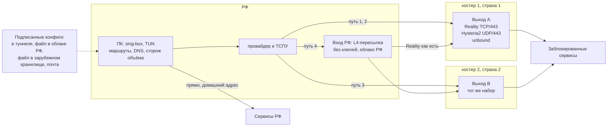

# Отказоустойчивая топология ПК в РФ -> заграничный сервер

Состояние источников на 02.11.2026. Ссылки вида [S3] ведут в раздел 10. Числа про стенд взяты только из `lab/results/`, про реальные сети только из `data/`.

<!-- РАЗДЕЛ 0 -->

## 1. Что известно про ТСПУ

Сила источника: A рецензируемая работа с первичными данными, B открытые замеры или пресса со ссылкой на документ, C отчёты сообщества с техническими деталями, D одиночный отчёт. Всё, что ниже без ссылки, помечено словом «гипотеза».

| Поведение | Что наблюдали | Источник, дата, сила | В модели |
|---|---|---|---|
| Место и направление | Устройство стоит в пути, ведёт состояние, блокирует только соединения, начатые изнутри РФ. 70 % найденных точек не дальше двух хопов от абонента | [S1] IMC, 10.2022, A | вся модель работает на выход |
| Блок по SNI, RST | После ClientHello ответы сервера усекаются, флаги становятся RST/ACK, seq и TTL не меняются | [S1] A | `sni_rst` |
| Блок по SNI, дроп | Дроп с обеих сторон, включая сам ClientHello. Другой вариант: ещё 5-8 пакетов и симметричный дроп | [S1] A | `sni_drop` |
| QUIC | До середины 2023 блокировался весь QUIC v1 к UDP/443 от 1001 байта. Сейчас Initial дешифруется, блоклист SNI почти совпадает с TCP, дроп 4-кортежа на 420 с, все UDP-порты, только наружу, только v1 | [S2] FOCI, 2026, A | `quic_all`, `quic_sni` |
| WireGuard и OpenVPN | С 07.08.2023 массовые отчёты о блокировке у ряда ISP. Часть авторов называет порог числа пакетов после рукопожатия. Точная сигнатура не опубликована, моя сигнатура в модели это гипотеза | [S9] 08.2023, C | `vpn_sig` |
| «Занавес», TCP 16-20 | TLS к адресу в AS зарубежного хостинга, больше 15-20 КБ от сервера в одном соединении: заморозка без RST. Подтверждено Cloudflare для своих адресов с 09.06.2025. Сначала в основном мобильные сети, с октября 2025 проводные. Позже описаны белый список SNI, белый список CIDR, счёт 25 пакетов в любую сторону для TCP и UDP, блок адреса на UDP около 10 минут | [S3] 06.2025-10.2025, C; [S4] 26.06.2025, B; [S5] инструмент | `curtain_tls`, `curtain_all` |
| Полностью зашифрованный поток | Для РФ описан не признак случайности, а рисунок HTTPS внутри туннеля: клиент шлёт не меньше трёх пакетов от 411 байт, сервер шлёт чаще клиента. Правила Ex1-Ex5 по первому пакету показаны только для GFW | [S7] 05.2024, C; [S8] GFW, 2023, A | `fet_ru`, `fet_gfw` |
| Полисинг TLS | С ноября 2025 на домашних сетях Reality+Vision умирает под нагрузкой, адрес восстанавливается примерно за 60 с, только порт 443, другие порты работают. С февраля 2026 волна блокировок, где Server Hello не возвращается. В мае 2026 отчёты о лимите числа соединений, порог называют 12 | [S6] 11.2025-02.2026, C; [S15] 22.05.2026, D | `conn_limit` |
| Баны по IP волнами | 04.08 и 21.09.2026 массовые баны адресов популярных VPS, в том числе с одной только AmneziaWG. В одной выборке 5 тысяч из 30 тысяч адресов AS, в другой 131 из 20 тысяч. Один адрес разблокировали через две недели | [S14] 09-10.2026, C | не моделируется, см. раздел 5 |
| Белые списки на мобильной сети | Режим, где проходит только разрешённое. В ЦФО в июле 2026 без ограничений 30,5 % сессий, в приграничных регионах почти 90 % сессий идёт по белому списку. Разрешения на уровне /24, различаются по оператору, региону и дню. Пилот: 4 из 28 рабочих конфигов прошли по SIM, все VLESS+Reality с разрешённым SNI на разрешённом адресе, XHTTP 0 из 2, WebSocket 0 из 8 | [S10] 09.2025, C; [S13] 08.2026, B; [S11] 10.2026, C | `wl_ip` |
| Закрытие лазеек белого списка | Минцифры просит хостеров и CDN вынести разрешённые ресурсы в отдельные подсети, прямо называя VPN | [S12] 31.08.2026, B | нет |
| DNS | UDP DNS к 8.8.8.8 подменяется на многих ISP, TCP DNS работает. У провайдеров обязательный вышестоящий НСДИ | [S16] 26.08.2026, C; [S17] 02.2026, C | нет |
| Отпечатки DTLS | Фильтр по ja3/ja4 для Snowflake с 30.03.2026 | [S19] 04.2026, C | нет |
| Активное зондирование | Массовых зондов от ТСПУ в рассмотренных источниках нет, есть косвенные жалобы. Для GFW это норма. Для ТСПУ гипотеза | нет прямого источника | `run/probe.py` |
| Определение VPN на устройстве | 22 из 30 российских приложений определяют VPN, 19 отправляют статус на сервер. Методика включает проверку локальных прокси-портов, что позволяет узнать выходной адрес | [S20] 04.2026, B; [S21] 14.04.2026, D | нет |

Обзорных отчётов Censored Planet по ТСПУ за 2025-2026 я не нашёл. Полного текста RKS Global по белым спискам тоже нет, есть работа RKS про приложения [S20]. Рецензируемой работы про обнаружение Reality или XHTTP не нашёл. Всё, что сообщество пишет про «сломанный Reality», это отчёты пользователей без дампов, что отдельно замечено в самой ветке [S15].

## 2. Топология



```
                     РФ                         │            за границей
  ┌──────────────┐   ┌───────────┐              │
  │ ПК           │──▶│ провайдер │──путь 1,2──────────▶ Выход A (хостер 1, AS1)
  │ sing-box TUN │   │ + ТСПУ    │──путь 3────────────▶ Выход B (хостер 2, AS2)
  │ сторож       │   └─────┬─────┘              │        │
  └──────┬───────┘         └──путь 4──▶ Вход РФ ─────────┘ L4, шифр Reality не снимается
         │                              (облако)│
         └── сервисы РФ напрямую                │        выходы ──▶ заблокированные сервисы
```

Пути по порядку:

| Путь | Маршрут | Транспорт | Закрывает | Не закрывает |
|---|---|---|---|---|
| 1 | ПК -> Выход A | VLESS+Reality+Vision, TCP/443 | блок по SNI, сигнатуры VPN, признаки полностью зашифрованного потока | «занавес», бан адреса, полисинг TLS, белый список |
| 2 | ПК -> Выход A | Hysteria2 с Salamander, UDP/443 | всё из пути 1, блок TCP/443 при живом UDP, QUIC-фильтр | бан адреса, блок всего UDP, счёт пакетов из [S3] upd5 |
| 3 | ПК -> Выход B | то же, что пути 1 и 2 | бан адреса и AS выхода A, отказ хостера | «занавес» на всём диапазоне хостингов |
| 4 | ПК -> Вход РФ -> A или B | Reality с разрешённым SNI, пересылка L4 | «занавес» и белый список, пока адрес входа разрешён | закрытие подсетей [S12], блок трансграничного участка [S27] |

Что где стоит:

- **ПК.** sing-box в режиме TUN с `strict_route`, плюс маленький сторож объёма (раздел 4.3). Локального SOCKS без авторизации нет [S21]. Ключи и список узлов лежат в файле, доступном только сервису.
- **Выходы A и B.** Xray VLESS+Reality на TCP/443 и Hysteria2 на UDP/443, как в части 3. Рядом `unbound` только для туннельных клиентов и второй inbound Reality на порту не 443 (причина: [S6], проверяется только реальной сетью). Журналов доступа нет, есть счётчики. Разные хостеры, разные AS, разные страны, адреса не из тех, что перечислены в волнах [S14].
- **Вход РФ.** Одна маленькая ВМ в российском облаке с `nftables` DNAT на выходы. Ключей Reality на ней нет, TLS она не снимает. Выбирается на день включения: адрес проверяется из SIM того оператора, который нужен [S11]. Подробности цены в разделе 3.
- **Управление.** Подпись конфигов делается офлайн на моём маке. Каналы раздачи и мониторинг в разделах 4.4 и 4.5.

## 3. Решения и что отброшено

| Решение | Почему | Что отброшено и какой ценой |
|---|---|---|
| Два выхода в разных AS, не один сервер | Бан идёт по адресам и целым AS волнами [S14]. Один сервер это один адрес и один отказ | Один сервер дешевле вдвое и проще, но любой бан адреса превращается в простой на время смены узла (раздел 4.6) |
| Вход РФ есть, но это резервный путь 4, а не основной | На проводном интернете прямой путь работает у многих, вход через РФ добавляет юрисдикцию и хоп. При этом при «занавесе» и белом списке прямой путь до хостинга мёртв по определению, а адрес внутри РФ этих правил не касается: стенд, раздел 8.2 | Всегда через РФ: каждый запрос проходит через хостера, который обязан подключиться к СОРМ [S28], и видно, кто и когда работает. Совсем без РФ: при режиме белого списка связи нет |
| Вход РФ это L4-пересылка без ключей | Захват входа даёт адреса клиента и выходов и объём, но не содержимое и не ключи | VLESS на входе с вторым туннелем дальше: можно менять транспорт на межсерверном участке, но вход тогда видит расшифрованный поток VLESS. Цена отказа: межсерверный участок идёт тем же Reality и зависит от того, как ТСПУ относится к серверным каналам [S27] |
| CDN не в тракте данных | Cloudflare под «занавесом» с июня 2025 [S4]. CDN снимает TLS и видит всё, что внутри, включая незашифрованный слой VLESS. Минцифры отдельно давит на CDN [S12] | CDN как запасной вход: прячет адрес выхода и даёт общий адрес с чужими сайтами. Цена отказа: нет пути на случай, когда все адреса выходов забанены разом. Закрываю сменой узла, а не CDN. CDN оставлен только для раздачи подписанного файла |
| Reality основной, Hysteria2 запасной (Р2) | На модели оба проходят SNI, сигнатуры и эвристику. Reality не требует домена и сертификата и выглядит как TLS к настоящему сайту. Hysteria2 живёт, когда режут TCP/443, и быстрее на первом байте | WireGuard и OpenVPN: узнаются по рукопожатию [S9], на стенде режутся сразу. AmneziaWG: проходит сигнатуры, но это UDP без маскировки под протокол, и её адреса попали под те же баны [S14]. Shadowsocks-2022: не выглядит как TLS, подпадает под [S7], Xray помечает его устаревшим. Вариант оставить как холодный резерв на выходах, данных против нет |
| Hysteria2 с Salamander, а не чистый HTTP/3 | QUIC-фильтр смотрит на Initial v1. С Salamander нет Initial, на стенде поток проходит и `quic_all`, и `quic_sni`. Чистый Hysteria2 зависит от того, какой период QUIC-фильтра у оператора | Без обфускации сервер отвечает как HTTP/3 и выдерживает зондирование. С Salamander сервер молчит на чужие пакеты [S25], то есть это неопознанный UDP. Цена: потеря маскировки, если начнут блокировать неопознанный UDP. Выбор проверяется на реальной сети первым |
| sing-box на ПК | Один бинарник: TUN, правила, urltest, selector, Reality, Hysteria2 | Xray на клиенте: родной XHTTP, но нет такого TUN и групп. Цена: без XHTTP на клиенте. Если полисинг числа соединений подтвердится на моём операторе, XHTTP придётся вернуть отдельным локальным процессом Xray |
| Разделение маршрутов: РФ напрямую, остальное в туннель | Российские приложения проверяют VPN [S20]. Через туннель они узнают адрес выхода и дают его сверить | Всё в туннель: проще и не течёт, но российские сервисы видят иностранный адрес, а выходной адрес попадает к тем, кто его может отдать в блокировку. Только список заблокированного в туннель: список вечно отстаёт, и незаблокированные зарубежные сервисы видят домашний адрес |

## 4. Как это работает

### 4.1 Маршруты на ПК

Весь трафик попадает в TUN, решения принимает sing-box по порядку:

1. Адреса входа и выходов, DHCP, локальная сеть: напрямую.
2. Процессы из списка (банки, госуслуги, российские приложения): напрямую, по `process_name`. Причина [S20]: приложение не должно видеть адрес выхода.
3. Домены и адреса РФ (`geosite-category-ru`, `geoip-ru`): напрямую.
4. UDP/443 в браузер при активном TCP-пути: отказ, браузер уходит на TCP. Иначе QUIC внутри TCP-туннеля даёт двойное управление перегрузкой.
5. Всё остальное: группа `auto`.

Обновления правил приходят вместе с подписанным набором (раздел 4.4). Правила не тянутся с GitHub напрямую при старте, чтобы клиент запускался без интернета.

### 4.2 DNS

- Адреса входа и выходов записаны в конфиг числами. Домены для них не используются, поэтому подмена DNS [S16] и НСДИ [S17] старту не мешают.
- Зарубежные имена: внутри туннеля к `unbound` на выходе, запрос идёт по TCP к адресу в туннеле. Плюс FakeIP в TUN, чтобы приложения не упирались в ответ DNS до выбора маршрута.
- Российские имена: к DNS провайдера напрямую. Иначе российские CDN отдадут узлы не того города, и DNS-запросы к внутренним именам уйдут за границу.
- UDP DNS к зарубежным резолверам мимо туннеля запрещён. Его подменяют [S16].
- Клиент не должен ходить за чужими доменами через системный резолвер. В TUN это ловится правилом на порт 53.

Что видно: провайдер видит запросы только по российским именам. `unbound` на выходе видит зарубежные имена всех клиентов выхода, журнал запросов выключен.

### 4.3 Автоматическое переключение

Два уровня, потому что отказы бывают двух видов, и замер показал разницу (раздел 8.3).

**Уровень 1, связность.** `urltest` в sing-box: раз в 15 с HEAD через каждый путь, `tolerance` 300 мс, при переключении обрываются открытые соединения (`interrupt_exist_connections`). Ловит то, где соединение не устанавливается: бан адреса, блок порта, блок QUIC.

**Уровень 2, объём.** Сторож `lab/run/watchdog.py`: каждые 5 с качает через текущий путь объект 256 КиБ, что больше порога «занавеса». Не докачалось за 4 с или скорость упала ниже 1 КиБ/с на 2 с: переключает `selector` на следующий путь и сбрасывает соединения через Clash API. Ловит заморозку, где маленькие запросы идут, а большие нет.

Порядок обхода: 1, 2, 3, 4. Возврат на путь выше раз в 10 минут пробой объёма в обход текущего маршрута, чтобы не держать пользователя на входе РФ дольше нужного. Гистерезис нужен, чтобы блокировка с таймером 60 с [S6] не качала маршрут туда-сюда. Частота проб ограничена осознанно: сторож каждые 5 с по 256 КиБ это около 50 КБ/с постоянного трафика, на реальном клиенте интервал надо поднять, в простое проверять раз в минуту и только при наличии трафика в группе. Цена описана в разделе 6.

Запасные пути без трафика могут быть мертвы незаметно. Поэтому раз в час проба объёма идёт и по каждому резервному пути, результат идёт в телеметрию.

### 4.4 Раздача конфигов при блокировке канала

Конфиг содержит адреса выходов, поэтому утечка конфига приводит к блокировке адресов. Канал раздачи должен жить дольше, чем любой отдельный путь.

- Формат: JSON с номером версии и сроком годности, подпись ed25519 (ключ офлайн на маке), шифрование `age` на ключ клиента. Клиент принимает только версию больше текущей. Публичный ключ подписи вшит в клиент.
- Канал 1: внутри туннеля, через любой живой путь, раз в час. Новая версия приезжает заранее, до блокировки. Это основной канал.
- Канал 2: файл в объектном хранилище российского облака. Доступен в режиме белого списка, если адрес разрешён, то есть там, где остальное мертво.
- Канал 3: файл в зарубежном хранилище за CDN (не Cloudflare [S4]), имя файла производное от ключа клиента.
- Канал 4: письмо от меня вручную, файл открывается на ПК. Для полного отказа.

Перечитывать конфиг при старте и не падать, если каналы недоступны: последний рабочий конфиг продолжает работать. Часть каналов можно потерять, не потеряв связь, потому что шифрованный файл бесполезен цензору, а подпись защищает от подмены через чужой канал. Telegram не используется: заблокирован с марта 2026 [S22].

### 4.5 Мониторинг

Своей точки в РФ у стенда нет, поэтому внешний мониторинг в этой работе не развёрнут. Для боевой системы:

- Изнутри РФ: клиенты с согласием шлют агрегат «путь, AS, успех/отказ, байт до остановки» раз в час, без адреса клиента. Это единственный источник, который видит домашний и мобильный провайдер пользователя.
- Публичные точки: Globalping и check-host по своим адресам, редко. Они показывают доступность из дата-центров и не показывают «занавес» у абонента (раздел 8.5).
- Минимум одна постоянная проба на домашней линии и одна на SIM в РФ. Это деньги и решение владельца, а не техническая деталь.
- На выходах: живость `xray` и `hysteria`, число соединений, ошибки рукопожатия Reality, отдельный счётчик запросов не от клиентов, то есть то, что уходит в `target`. Рост такого трафика означает сканирование адреса.
- Отслеживать адреса выходов в публичных реестрах блокировок нельзя считать мониторингом: баны ТСПУ в реестр не попадают [S14].

### 4.6 Смена узла

- Образ не нужен: `cloud-init` ставит Xray и Hysteria2 с нуля, ключи генерируются на месте установки и новые для каждого узла.
- Новый узел всегда в другом адресе и, если бан по AS, у другого хостера. Заранее держу подготовленные учётные записи минимум у трёх хостеров, в разных платёжных схемах.
- Порядок: создать узел, проверить изнутри туннеля по уцелевшему пути, выпустить конфиг новой версии, дать ему разойтись, старый узел держать сутки для отстающих клиентов.
- Время создания узла измерено на DigitalOcean, раздел 8.4.

<!-- РАЗДЕЛ 5 -->

## 6. Слабые места

1. **Белый список на мобильной сети не решается топологией.** Работает только адрес из разрешённой /24 плюс разрешённый SNI, и то не всегда: 4 из 28 у пилота [S11], список зависит от оператора, региона и дня. Минцифры закрывает эту лазейку [S12]. На SIM система может просто не работать.
2. **Неотличимость Reality никем не доказана.** Рецензируемых замеров нет. Есть отчёты, что Reality падает волнами [S6] [S14] [S15], и нет дампов, которые показали бы признак. Возможный признак по гипотезе: SNI крупного сайта при адресе чужого AS. Документация Xray сама советует брать `target` из своего AS [S23]. На моей модели такого правила нет.
3. **Если «занавес» накрывает весь диапазон хостингов, вся нагрузка ложится на вход РФ.** Это одна ВМ в одной юрисдикции с СОРМ [S28].
4. **Вход РФ раскрывает связь.** Хостер видит адрес клиента, адрес выхода, время и объём, а у аренды есть плательщик с идентификацией. Содержимое он не видит, но для ответа на вопрос «кто пользуется обходом» этого хватает.
5. **Трансграничный участок входа не измерен.** Отчёты говорят, что серверные каналы фильтруются мягче, но жёстче, чем раньше [S27]. Стенд этого не показывает: вход и выход там на одной ВМ.
6. **Hysteria2 с Salamander это неопознанный UDP.** Правило «режем всё UDP к хостингам» убивает путь 2 целиком, такие отчёты на мобильных сетях уже есть [S26]. Без Salamander есть зависимость от того, какой период QUIC-фильтра действует.
7. **Сторож объёма сам виден.** Периодическое скачивание одного размера с одного адреса это рисунок. И реакция идёт после отказа: первый оборвавшийся поток пользователь заметит.
8. **Мониторинга из РФ сейчас нет.** Всё, что я знаю про живость путей у абонента, приходит от самих клиентов, то есть только когда есть живой канал.
9. **Объём на один адрес виден цензору.** В отчёте [S14] VPS с 130 ГБ за 8 дней потерял TCP по всей РФ, через две недели без действий блок сняли. Рассчитывать число пользователей на адрес не из чего: опубликованных порогов нет.
10. **Разделение маршрутов течёт по краям.** Список процессов и доменов неполон. Приложение в туннеле может узнать адрес выхода. Напрямую идущий трафик виден провайдеру как обычно. IPv6 в TUN надо закрывать явно, иначе часть запросов уйдёт мимо.
11. **Один ключ подписи на одном маке.** Потеря ключа это ручная перевыдача всем клиентам. Отзыв ключа через канал не проверялся.
12. **Выход это адрес дата-центра.** Часть сервисов сама не пускает такие адреса или показывает капчу. К блокировке РФ это отношения не имеет, но доступ к сервису тоже ломает. Лечится ещё одним хопом и новым доверенным участником, здесь не делается.
13. **Стенд ничего не доказывает про настоящий ТСПУ.** Он показывает только поведение протоколов при заявленных правилах. Цифры раздела 8.2 не надо читать как прогноз для живой сети.

## 7. Граница доверия

| Участник | Что видит | Что может | Кому и зачем надо верить |
|---|---|---|---|
| ПК и его ОС | всё в открытом виде, ключи, конфиг | всё | Полное доверие. Взлом ПК обнуляет систему |
| Провайдер и ТСПУ | адрес ПК, адреса и порты путей, SNI, объём, время, российский трафик и российский DNS | блокировать, тормозить, подменять открытый трафик, зондировать, сопоставлять с данными абонента | Не доверяю. Содержимое TLS 1.3 не видит, пока целы ключи X25519 и нет активного MITM с настоящим сертификатом |
| Хостер входа РФ | адрес ПК, адрес выхода, объём, время | всё то же, отдать по СОРМ, снять ВМ | Не доверяю содержимому, поэтому там нет ключей. Метаданные считаю раскрытыми |
| Хостер выхода | адрес ПК (на путях 1-3) или входа, назначения, открытый трафик клиента, ключи Xray и Hysteria2 в памяти ВМ | читать всё, что не защищено TLS внутри, подменять сервер | Вынужденное доверие. Клиент должен пользоваться внутренним TLS. Разные хостеры ограничивают ущерб только по времени и доле трафика |
| CDN | для раздачи конфигов: адрес запросившего и имя файла. В тракте данных его нет | отдать или не отдать файл | Нет: файл зашифрован и подписан |
| DNS | провайдер и НСДИ: российские имена. `unbound` на выходе: зарубежные имена | подменить российские ответы | Подмена российских имён остаётся в силе. Зарубежные защищены туннелем только до выхода, дальше обычный DNS, DNSSEC проверяется на `unbound` |
| Автор конфигов (я) | все ключи и адреса всех выходов, плательщик узлов | выпустить вредный конфиг, например завернуть трафик на свой узел | Полное доверие. Подпись защищает от чужого, а не от автора |
| Клиентское ПО (sing-box, сторож) | весь трафик до шифрования, ключи | всё | Открытый код, но я не читаю каждый релиз. Сборка из чужого бинарника |
| Поставка обновлений | версию ПО, адрес запроса к GitHub | подменить релиз, если взломан аккаунт сопровождающего | Закрепление версии и контрольной суммы, обновление вручную после проверки на стенде. Ключа подписи релизов у sing-box я не проверял |
| Конечный сервис | адрес выхода, аккаунт пользователя | связать аккаунт, отпечаток браузера, cookies | Обход этого не скрывает |

**Модель нарушителя.**

- Н1. Цензор на пути. Массовый, цель: не дать связи. Видит метаданные, инжектит и режет, знает AS хостингов, меняет правила без объявления, может зондировать (гипотеза). Считаю, что он не ломает TLS 1.3 и X25519, не держит белый список на проводных сетях повсеместно (допущение, с ним разваливается пункт 1 раздела 6).
- Н2. Оператор или хостер по законному запросу. Отдаёт метаданные, по [S28] это штатный путь на входе РФ.
- Н3. Хостер выхода или взломщик выхода. Читает открытый трафик и видит адрес клиента.
- Н4. Вредоносное или любопытное приложение на ПК, включая российские приложения с проверкой VPN [S20].
- Н5. Человек, получивший конфиг. Может использовать узел и передать адреса в блокировку. Защита только частичная: персональные ключи и отзыв по одному.
- Н6. Цепочка поставки.

Система рассчитана на Н1 и частично на Н5. От Н2 она защищает содержимое, но не факт использования. От Н3 защищает только внутренний TLS. От Н4 и Н6 не защищает.

**Чего система не гарантирует.** Анонимности: провайдер видит факт потока к адресу, выход видит адрес клиента и назначения, сервис видит аккаунт. Защиты от взлома устройства и от изъятия устройства. Доступности при отключении сети оператором или при белом списке на проводной линии. Скрытия факта использования обхода при целевом интересе. Законности применения в конкретной ситуации: это отдельный вопрос, а не свойство топологии.

<!-- РАЗДЕЛЫ 8-9 -->

## 10. Источники

Дата проверки всех ссылок 02.11.2026.

- [S1] Xue et al., TSPU: Russia's Decentralized Censorship System, IMC 2022. https://par.nsf.gov/servlets/purl/10379650
- [S2] Heitmann, Niere, Lange, Somorovsky, On Russia's Early Introduction of QUIC SNI Censorship, FOCI 2026. https://www.petsymposium.org/foci/2026/foci-2026-0010.php , обзор https://github.com/net4people/bbs/issues/654
- [S3] hyperion-cs, [Russia] Censor has a new method of blocking, 27.06.2025 и далее. https://github.com/net4people/bbs/issues/490
- [S4] Cloudflare, Russian Internet users are unable to access the open Internet, 26.06.2025. https://blog.cloudflare.com/russian-internet-users-are-unable-to-access-the-open-internet/
- [S5] dpi-checkers. https://github.com/hyperion-cs/dpi-checkers
- [S6] 0x3mp7y, TLS connection-based policing on home ISPs, 14.11.2025 и далее. https://github.com/net4people/bbs/issues/546
- [S7] Blocking of fully encrypted protocols in Russia, 13.05.2024. https://github.com/net4people/bbs/issues/363
- [S8] Wu et al., How the Great Firewall of China Detects and Blocks Fully Encrypted Traffic, USENIX Security 2023. https://gfw.report/publications/usenixsecurity23/en/
- [S9] OpenVPN and WireGuard blocking in multiple ISPs, 07.08.2023. https://github.com/net4people/bbs/issues/274
- [S10] Mobile network website whitelist, 07.09.2025. https://github.com/net4people/bbs/issues/516
- [S11] Обход белых списков мобильного интернета, 19.08.2026, комментарий 08.10.2026, https://github.com/net4people/bbs/issues/650 ; пилот allowlist-probe https://github.com/vadim-tolmachev/allowlist-probe
- [S12] Коммерсантъ, 31.08.2026. https://www.kommersant.ru/doc/8922142
- [S13] Vigo через Коммерсантъ и Meduza, 05.08.2026. https://meduza.io/en/news/2026/08/05/kommersant-only-one-third-of-mobile-internet-traffic-in-central-russia-was-unrestricted-nearly-90-in-border-regions-went-through-whitelists
- [S14] recent mass ip bans, 30.09.2026 и далее. https://github.com/net4people/bbs/issues/671
- [S15] ntc.party, Какие протоколы остались, 22.05.2026. https://ntc.party/t/какие-протоколы-остались-тспу-блочит-всё-что-я-пробовал/24845
- [S16] dns hijacking in russia, 26.08.2026. https://github.com/net4people/bbs/issues/657
- [S17] НСДИ, 23.02.2026. https://github.com/net4people/bbs/issues/580
- [S18] Cloudflare reachability from one Moscow AS follows the IP prefix, 02.09.2026. https://github.com/net4people/bbs/issues/662
- [S19] Snowflake-targeted DTLS filtering, 06.04.2026. https://github.com/net4people/bbs/issues/603
- [S20] Spyware modules, разбор RKS Global, 10.04.2026. https://github.com/net4people/bbs/issues/605
- [S21] sogonov, Anubis: заморозка приложений по состоянию VPN, 14.04.2026. https://habr.com/ru/articles/1023352/
- [S22] OONI, Russia blocked Telegram, 30.03.2026. https://explorer.ooni.org/findings/96225549500
- [S23] Документация Xray REALITY. https://xtls.github.io/config/transports/reality.html
- [S24] XHTTP: Beyond REALITY. https://github.com/XTLS/Xray-core/discussions/4113
- [S25] Hysteria 2, полный конфиг сервера. https://v2.hysteria.network/docs/advanced/Full-Server-Config/
- [S26] ntc.party, Hysteria2 не работает на Теле2. https://ntc.party/t/hysteria2-не-работает-на-теле2-походу-полный-блок-quic/20340
- [S27] xray-client --> domestic VPS <-- foreign VPS, 08.09.2026. https://github.com/XTLS/Xray-core/discussions/6740
- [S28] Хабр, Хостинг-провайдеров России обязали подключиться к СОРМ. https://habr.com/ru/articles/803421 ; реестр и запрет услуг вне реестра с 01.02.2025: https://www.securitylab.ru/news/559236.php
- [S29] Документация Xray Freedom, запрет приватных адресов по умолчанию. https://xtls.github.io/config/outbounds/freedom.html
